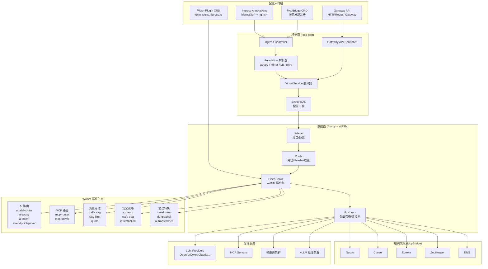
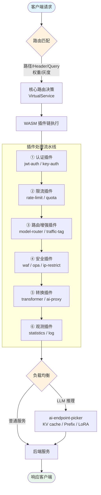

# Higress 路由策略全解析

> 分析对象：[higress-group/higress](https://github.com/higress-group/higress) CNCF Sandbox 项目
>
> 分析日期：2026-10-27

---

## 文档索引

| 文档 | 内容 |
|------|------|
| [01-路由配置面](./01-route-configuration-surfaces.md) | CRD、Ingress Annotation、Gateway API 三种配置入口 |
| [02-核心路由策略](./02-core-routing-strategies.md) | 路径、Header、权重、灰度、镜像、负载均衡、重试、回退 |
| [03-LLM/AI 路由](./03-llm-ai-routing.md) | 模型路由、语义路由、端点选择、协议转换、AI 代理 |
| [04-MCP 路由](./04-mcp-routing.md) | MCP 工具路由、REST-to-MCP 桥接、协议适配 |
| [05-流量治理策略](./05-traffic-management.md) | 限流、配额、认证、WAF、转换、染色 |
| [06-典型路由编排](./06-routing-pipelines.md) | 端到端路由流水线示例 |

## 一句话总结

Higress 提供**四层路由体系**：控制面翻译层（Ingress/Gateway API → Istio VirtualService）、WASM 插件链（AI/MCP/流量治理/安全）、服务发现层（McpBridge 统一 Nacos/Consul/Eureka/ZK/DNS）、推理调度层（GIE v1.4 InferencePool + ai-endpoint-picker），覆盖路径/Header/Query/权重/灰度/镜像/意图/语义/模型/MCP 全维度路由，并通过统一 WasmPlugin 绑定模型实现策略即代码。

## 整体架构图

## 路由决策流程图

## 路由策略分类速查

| 策略类型 | 实现方式 | 关键插件/Annotation |
|---------|---------|-------------------|
| 路径路由 | Ingress path/pathType | 原生 Ingress spec |
| Header 路由 | Annotation + VirtualService | `canary-by-header`, `traffic-tag` |
| 权重路由 | Ingress annotation | `higress.io/destination`, `canary-weight` |
| 灰度发布 | Annotation + Plugin | `canary-*`, `frontend-gray` |
| 流量镜像 | Annotation | `mirror-target-service`, `mirror-percentage` |
| 负载均衡 | Annotation + Plugin | `load-balance`, `ai-load-balancer` |
| 模型路由 | Plugin | `model-router`, `model-mapper` |
| 语义路由 | Plugin | `ai-intent`, `model-router.autoRouting` |
| 端点选择 | Plugin | `ai-endpoint-picker` |
| MCP 路由 | Plugin | `mcp-router`, `mcp-server` |
| 限流配额 | Annotation + Plugin | `local-rate-limit`, `ai-token-ratelimit`, `ai-quota` |
| 认证鉴权 | Plugin | `key-auth`, `jwt-auth`, `oidc`, `ext-auth` |
| 协议转换 | Plugin | `ai-proxy`, `de-graphql`, `jsonrpc-converter` |
