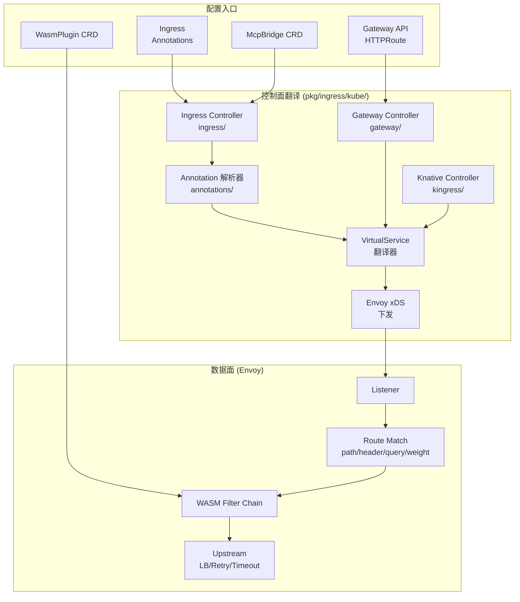
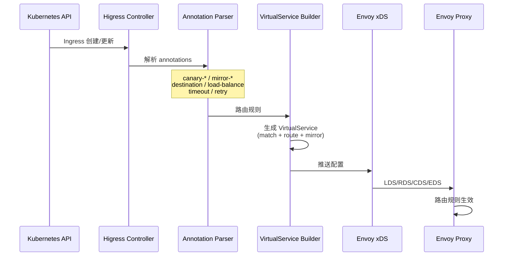

# 01 — 路由配置面

> Higress 提供三种路由配置入口：Ingress Annotations、Kubernetes Gateway API、WasmPlugin CRD，分别面向传统用户、Gateway API 用户和插件扩展用户。

---


## 架构总览



## 配置面翻译流程




## 1. CRD 资源模型

Higress 扩展了三个核心 CRD，源码定义在 `api/kubernetes/customresourcedefinitions.gen.yaml`：

### 1.1 McpBridge — 服务发现注册中心

```yaml
apiVersion: networking.higress.io/v1
kind: McpBridge
metadata:
  name: default
  namespace: higress-system
spec:
  registries:
    - name: nacos-prod
      type: nacos          # nacos | consul | eureka | zookeeper | dns
      domain: nacos.svc.cluster.local
      port: 8848
      nacosNamespaceId: public
    - name: consul-prod
      type: consul
      domain: consul.svc.cluster.local
      port: 8500
```

**作用**：统一 Nacos/Consul/Eureka/ZooKeeper/DNS/MCP 多种注册中心，Ingress 通过 `higress.io/destination` annotation 引用 McpBridge 中的服务发现目标。

### 1.2 WasmPlugin — 插件绑定

```yaml
apiVersion: extensions.higress.io/v1alpha1
kind: WasmPlugin
metadata:
  name: ai-proxy-on-llm-route
  namespace: higress-system
spec:
  selector:
    ingress:
      - default/my-llm-ingress    # 绑定到特定 Ingress
  url: oci://higress-registry.cn-hangzhou.cr.aliyuncs.com/plugins/ai-proxy:1.0.0
  pluginConfig:
    provider:
      type: qwen
      apiTokens: ["sk-xxx", "sk-yyy"]
    modelMapping:
      'gpt-4': "qwen-max"
```

**作用**：将 Wasm 插件绑定到特定路由/域名，实现策略即代码。支持 OCI 镜像或本地文件 (`file:///opt/plugins/...`)。

### 1.3 Http2Rpc — HTTP-to-Dubbo 转换

```yaml
apiVersion: networking.higress.io/v1
kind: Http2Rpc
metadata:
  name: dubbo-service-convert
spec:
  dubboServiceConfig:
    interface: com.example.UserService
    version: 1.0.0
    group: default
  httpMethods:
    - path: /user/get
      method: GET
      dubboMethod: getUser
      params:
        - name: userId
          type: java.lang.String
```

**作用**：将 HTTP REST 请求转换为 Dubbo RPC 调用，实现 HTTP-to-RPC 协议桥接。

---

## 2. Ingress Annotations 全量清单

Higress 在标准 Ingress 基础上扩展了大量 annotation，解析逻辑位于 `pkg/ingress/kube/annotations/`。

### 2.1 流量切分与灰度

| Annotation | 策略类型 | 说明 |
|-----------|---------|------|
| `higress.io/destination` | 多权重后端 | `33% svc-a; 33% svc-b; 34% svc-c` 权重分配 |
| `nginx.ingress.kubernetes.io/canary: 'true'` | 灰度发布 | 启用 canary 规则 |
| `canary-by-header` / `canary-by-header-value` | Header 灰度 | 按 Header 精确匹配路由到灰度 |
| `canary-by-header-pattern` | Header 正则灰度 | 按 Header 正则匹配 |
| `canary-by-cookie` | Cookie 灰度 | 按 Cookie 值路由 |
| `canary-weight` / `canary-weight-total` | 权重灰度 | 按百分比切分流量（默认 total=100） |

**配置示例**：
```yaml
apiVersion: networking.k8s.io/v1
kind: Ingress
metadata:
  annotations:
    nginx.ingress.kubernetes.io/canary: "true"
    nginx.ingress.kubernetes.io/canary-by-header: "x-canary"
    nginx.ingress.kubernetes.io/canary-by-header-value: "true"
    nginx.ingress.kubernetes.io/canary-weight: "20"
spec:
  rules:
    - host: api.example.com
      http:
        paths:
          - path: /api
            backend:
              service:
                name: api-v2-canary
                port:
                  number: 8080
```

### 2.2 流量镜像

| Annotation | 说明 |
|-----------|------|
| `higress.io/mirror-target-service` | 镜像目标（K8s Service） |
| `higress.io/mirror-target-fqdn` | 镜像目标（FQDN） |
| `higress.io/mirror-percentage` | 镜像百分比 |

**配置示例**：
```yaml
metadata:
  annotations:
    higress.io/mirror-target-fqdn: shadow.api.example.com
    higress.io/mirror-percentage: "10"
```

**行为语义**：10% 流量会被镜像到 shadow 服务，主请求不受影响。

### 2.3 超时与重试

| Annotation | 说明 |
|-----------|------|
| `higress.io/timeout` | 路由超时（秒） |
| `higress.io/proxy-next-upstream` | 重试条件（`error`, `timeout`, `invalid_header` 等） |
| `higress.io/proxy-next-upstream-tries` | 最大重试次数 |
| `higress.io/proxy-next-upstream-timeout` | 重试总超时 |
| `higress.io/retriable-status-codes` | 触发重试的 HTTP 状态码（如 `502,503,504`） |

### 2.4 负载均衡与会话亲和

| Annotation | 说明 |
|-----------|------|
| `higress.io/load-balance` | 负载均衡算法（`round_robin`, `random`, `least_request`, `ring_hash`） |
| `higress.io/upstream-hash-by` | 一致性哈希键（`$http_x_user_id`, `$arg_session_id`, `$cookie_session`） |
| `higress.io/affinity` | 会话亲和（`cookie`） |
| `higress.io/affinity-mode` | 亲和模式（`balanced`） |
| `higress.io/session-cookie-name` | Cookie 名称 |
| `higress.io/session-cookie-path` | Cookie 路径 |
| `higress.io/session-cookie-max-age` | Cookie 有效期 |
| `higress.io/mcp-sse-stateful-param-name` | MCP SSE 有状态参数（如 `sessionId`） |

### 2.5 URL 重写与重定向

| Annotation | 说明 |
|-----------|------|
| `higress.io/rewrite-target` | 重写目标路径 |
| `higress.io/rewrite-regex` | 重写正则匹配 |
| `higress.io/redirect-code` | HTTP 重定向状态码（301/302/307/308） |
| `higress.io/redirect-host` | 重定向目标 Host |
| `higress.io/redirect-path` | 重定向目标路径 |

### 2.6 TLS 与上游协议

| Annotation | 说明 |
|-----------|------|
| `higress.io/upstream-vhost` | 上游 Host（覆盖 Host Header） |
| `higress.io/backend-protocol` | 后端协议（`HTTP`, `HTTPS`, `GRPC`, `GRPCS`） |
| `higress.io/upstream-tls-verify` | 上游 TLS 验证 |
| `higress.io/upstream-tls-verify-cert` | 上游 TLS 证书 |
| `higress.io/downstream-tls-secret` | 下游 TLS 证书 Secret |
| `higress.io/ssl-passthrough` | TLS 透传（不终止 TLS） |

### 2.7 Header 控制

| Annotation | 说明 |
|-----------|------|
| `higress.io/header-add-*` | 添加请求/响应 Header |
| `higress.io/header-remove-*` | 删除请求/响应 Header |
| `higress.io/header-request-*` | 请求 Header 控制 |
| `higress.io/header-response-*` | 响应 Header 控制 |

### 2.8 限流与访问控制

| Annotation | 说明 |
|-----------|------|
| `higress.io/local-rate-limit-enabled` | 启用本地限流 |
| `higress.io/local-rate-limit-rps` | 每秒请求数限制 |
| `higress.io/local-rate-limit-burst` | 突发容量 |
| `higress.io/whitelist-source-range` | IP 白名单（CIDR） |
| `higress.io/cors-allow-origin` | CORS 允许的来源 |
| `higress.io/cors-allow-methods` | CORS 允许的方法 |
| `higress.io/cors-allow-headers` | CORS 允许的 Header |

### 2.9 其他

| Annotation | 说明 |
|-----------|------|
| `higress.io/ignore-case` | 路径大小写不敏感匹配 |
| `higress.io/default-backend` | 默认后端（404 兜底） |

---

## 3. Gateway API 支持

Higress 完整实现了 Kubernetes Gateway API 规范，控制器位于 `pkg/ingress/kube/gateway/`：

### 3.1 支持的资源

- **GatewayClass** — 网关类型声明
- **Gateway** — 网关实例（监听器、地址）
- **HTTPRoute** — HTTP 路由规则（匹配、过滤、后端）
- **TCPRoute** / **TLSRoute** — 四层路由（部分支持）
- **InferencePool** — Gateway API Inference Extension (GIE) v1.4

### 3.2 HTTPRoute 示例

```yaml
apiVersion: gateway.networking.k8s.io/v1
kind: HTTPRoute
metadata:
  name: llm-route
spec:
  parentRefs:
    - name: higress
      namespace: higress-system
  hostnames:
    - "api.example.com"
  rules:
    - matches:
        - path:
            type: PathPrefix
            value: /v1/chat
      filters:
        - type: RequestHeaderModifier
          requestHeaderModifier:
            add:
              - name: x-custom-header
                value: "llm-traffic"
      backendRefs:
        - name: llm-service
          port: 8080
          weight: 80
        - name: llm-service-canary
          port: 8080
          weight: 20
```

### 3.3 InferencePool (GIE v1.4)

```yaml
apiVersion: inference.networking.k8s.io/v1alpha2
kind: InferencePool
metadata:
  name: qwen-pool
spec:
  targetPortNumber: 8000
  selector:
    app: qwen-inference
  endpointPickerRef:
    name: ai-endpoint-picker
    kind: Extension
    group: extensions.higress.io
```

**作用**：声明一组推理端点池，配合 `ai-endpoint-picker` 或外部 EPP（ext_proc）实现 KV cache 感知、前缀缓存亲和、LoRA 亲和的端点选择。

---

## 4. McpBridge 服务发现语法

`higress.io/destination` annotation 支持复杂的多权重服务发现：

```yaml
metadata:
  annotations:
    higress.io/destination: |
      33% service-provider.DEFAULT-GROUP.public.nacos
      33% service-provider-gray.DEFAULT-GROUP.public.nacos
      34% bar-service.default.svc.cluster.local:5678
```

**语法规则**：
- 每行一个服务，格式：`权重% 服务名[:端口]`
- 服务名支持 Nacos/Consul/Eureka 的服务发现格式
- K8s Service 使用 `name.namespace.svc.cluster.local` 格式
- 权重总和应为 100（或等比例）

---

## 5. 配置面选择建议

| 场景 | 推荐配置面 |
|------|-----------|
| 简单 HTTP 路由 + 灰度 | Ingress Annotations |
| 多服务权重切分 | `higress.io/destination` |
| 复杂 Header/Query 匹配 | Gateway API HTTPRoute |
| AI 模型路由 + 协议转换 | WasmPlugin (ai-proxy) |
| MCP 工具路由 | WasmPlugin (mcp-router) |
| 推理端点调度 | Gateway API InferencePool |
| HTTP-to-Dubbo | Http2Rpc CRD |

---

## 6. 源码位置

| 模块 | 路径 |
|------|------|
| Ingress Annotation 解析 | `pkg/ingress/kube/annotations/` |
| Gateway API 控制器 | `pkg/ingress/kube/gateway/` |
| Knative Ingress 适配 | `pkg/ingress/kube/kingress/` |
| CRD 定义 | `api/kubernetes/customresourcedefinitions.gen.yaml` |
| WasmPlugin 定义 | `api/extensions/v1alpha1/` |
| McpBridge 控制器 | `pkg/ingress/kube/mcpbridge/` |
