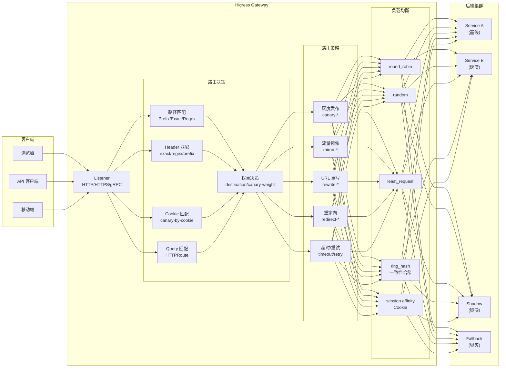
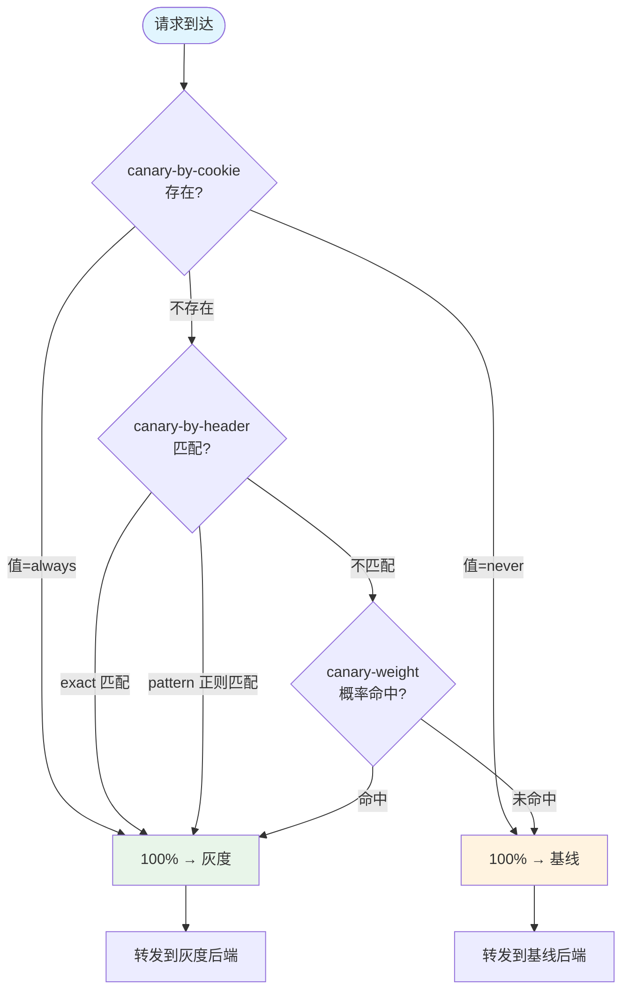
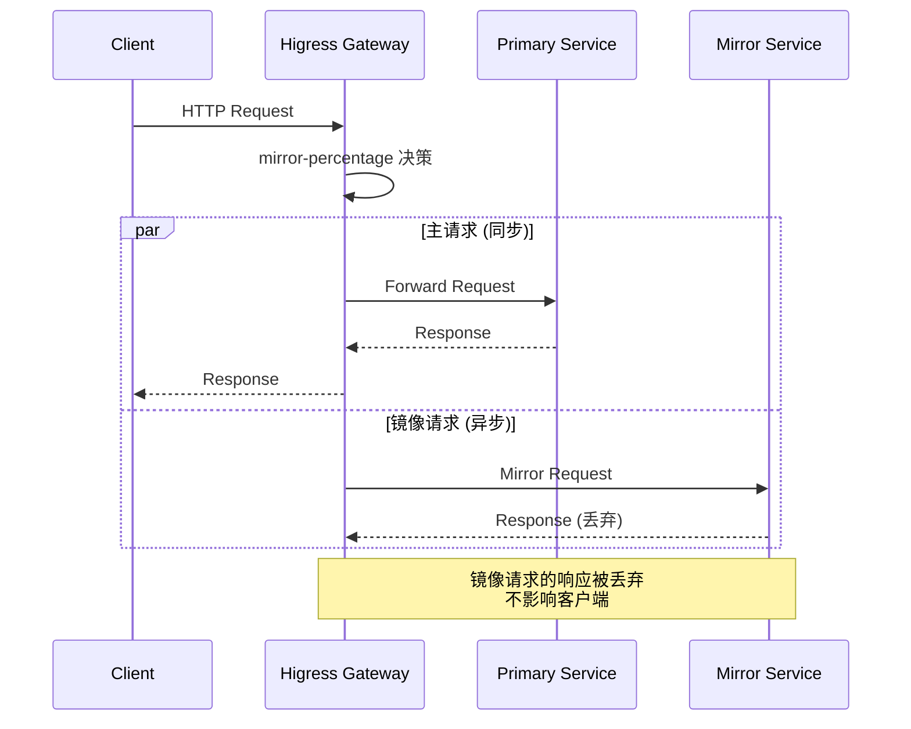

# 02 — 核心路由策略

> Higress 基于 Istio + Envoy 数据面，在控制面完成了传统网关的全部核心路由能力：路径匹配、Header/Query 条件、权重切分、灰度发布、流量镜像、负载均衡、重试容错、URL 改写。

---


## 架构总览



## 灰度决策流程



## 流量镜像流程




## 1. 路径路由

最基础的路由维度，基于 HTTP 请求的 URL 路径进行匹配。

### 1.1 匹配模式

| 模式 | Ingress pathType | Gateway API | 示例 |
|------|-----------------|-------------|------|
| 精确匹配 | `Exact` | `Exact` | `/api/v1/users` |
| 前缀匹配 | `Prefix` | `PathPrefix` | `/api/*` |
| 正则匹配 | 不支持（需 annotation） | `RegularExpression` | `^/api/v[0-9]+/.*` |

### 1.2 大小写控制

通过 `higress.io/ignore-case: "true"` annotation 可开启路径大小写不敏感匹配。

### 1.3 Ingress 示例

```yaml
apiVersion: networking.k8s.io/v1
kind: Ingress
metadata:
  name: api-route
spec:
  rules:
    - host: api.example.com
      http:
        paths:
          - path: /api/v1
            pathType: Prefix
            backend:
              service:
                name: api-service
                port:
                  number: 8080
          - path: /health
            pathType: Exact
            backend:
              service:
                name: health-service
                port:
                  number: 8080
```

**源码位置**：`pkg/ingress/kube/ingress/controller.go`

---

## 2. Header / Cookie / Query 条件路由

在路径匹配基础上，进一步根据请求属性做精细路由。

### 2.1 Header 匹配

通过 canary annotation 或 Gateway API HTTPRoute 实现：

```yaml
# Ingress annotation 方式
metadata:
  annotations:
    nginx.ingress.kubernetes.io/canary: "true"
    nginx.ingress.kubernetes.io/canary-by-header: "x-env"
    nginx.ingress.kubernetes.io/canary-by-header-value: "staging"
    # 或使用正则
    nginx.ingress.kubernetes.io/canary-by-header-pattern: "^staging|pre-.*"
```

```yaml
# Gateway API 方式
spec:
  rules:
    - matches:
        - headers:
            - name: x-env
              value: staging
          queryParams:
            - name: version
              value: v2
```

### 2.2 Cookie 匹配

```yaml
metadata:
  annotations:
    nginx.ingress.kubernetes.io/canary: "true"
    nginx.ingress.kubernetes.io/canary-by-cookie: "canary-user"
    # Cookie 值为 "always" 路由到灰度，"never" 路由到基线
```

### 2.3 Istio VirtualService 层面

Higress 控制面将上述 annotation 翻译为 Istio `HTTPMatchRequest`：

```yaml
# 控制面生成的 VirtualService（简化）
spec:
  http:
    - match:
        - headers:
            x-env:
              exact: staging
          uri:
            prefix: /api
      route:
        - destination:
            host: api-canary
      # ...
```

**源码位置**：`pkg/ingress/kube/annotations/canary.go`

---

## 3. 权重路由 / 流量切分

将请求按权重分配到多个后端。

### 3.1 Ingress destination annotation

```yaml
metadata:
  annotations:
    higress.io/destination: |
      80% api-service.default.svc.cluster.local
      20% api-service-canary.default.svc.cluster.local
```

**行为语义**：80% 流量到 api-service，20% 到 canary 版本。

### 3.2 Canary weight

```yaml
metadata:
  annotations:
    nginx.ingress.kubernetes.io/canary: "true"
    nginx.ingress.kubernetes.io/canary-weight: "15"
    nginx.ingress.kubernetes.io/canary-weight-total: "100"  # 默认 100
```

### 3.3 Gateway API HTTPRoute

```yaml
spec:
  rules:
    - backendRefs:
        - name: api-service
          weight: 80
        - name: api-canary
          weight: 20
```

**源码位置**：`pkg/ingress/kube/annotations/destination.go`

---

## 4. 灰度发布（多维匹配）

灰度发布是权重路由、Header 路由、Cookie 路由的组合策略。

### 4.1 灰度决策优先级

`canary.go` 实现了以下优先级链：

```
1. canary-by-cookie 值 = "always"     → 100% 到灰度
2. canary-by-cookie 值 = "never"      → 100% 到基线
3. canary-by-header 值精确匹配          → 100% 到灰度
4. canary-by-header-pattern 正则匹配    → 100% 到灰度
5. canary-weight 按权重随机             → 按概率分配
```

### 4.2 灰度回退链

支持 primary → fallback 的有序目标链：

```yaml
metadata:
  annotations:
    higress.io/destination: |
      100% primary-service.default.svc.cluster.local
    higress.io/fallback-service: |
      fallback-a.default.svc.cluster.local
      fallback-b.default.svc.cluster.local
```

**行为语义**：当 primary 不可用时，依次尝试 fallback-a、fallback-b。

---

## 5. 流量镜像（Shadow Traffic）

将流量复制到镜像目标，不影响主请求。常用于测试新版本、录制流量。

### 5.1 配置

```yaml
metadata:
  annotations:
    higress.io/mirror-target-service: shadow-api.default.svc.cluster.local
    # 或者用 FQDN（外部服务）
    # higress.io/mirror-target-fqdn: shadow.example.com
    # higress.io/mirror-target-port: "8080"
    higress.io/mirror-percentage: "10"
```

### 5.2 行为语义

- `mirror-percentage: "10"` → 10% 请求被镜像
- 镜像请求的响应被丢弃，不影响客户端
- 镜像请求的 Host Header 保持不变

**源码位置**：`pkg/ingress/kube/annotations/mirror.go`

---

## 6. 负载均衡

### 6.1 基础负载均衡

```yaml
metadata:
  annotations:
    higress.io/load-balance: "round_robin"  # round_robin | random | least_request | ring_hash
```

### 6.2 一致性哈希

```yaml
metadata:
  annotations:
    higress.io/load-balance: "ring_hash"
    higress.io/upstream-hash-by: "$http_x_user_id"
    # 支持: $http_* (Header), $arg_* (Query), $cookie_* (Cookie), $remote_addr (源 IP)
```

### 6.3 会话亲和（Sticky Session）

```yaml
metadata:
  annotations:
    higress.io/affinity: "cookie"
    higress.io/affinity-mode: "balanced"
    higress.io/session-cookie-name: "SERVERID"
    higress.io/session-cookie-path: "/"
    higress.io/session-cookie-max-age: "86400"
```

### 6.4 MCP SSE 有状态路由

```yaml
metadata:
  annotations:
    higress.io/mcp-sse-stateful-param-name: "sessionId"
    # 同一 sessionId 的请求路由到同一后端，保证 SSE 连接状态
```

**源码位置**：`pkg/ingress/kube/annotations/loadbalance.go`

---

## 7. 超时与重试

### 7.1 路由超时

```yaml
metadata:
  annotations:
    higress.io/timeout: "30"  # 秒
```

### 7.2 重试策略

```yaml
metadata:
  annotations:
    higress.io/proxy-next-upstream: "error timeout http_502 http_503"
    higress.io/proxy-next-upstream-tries: "3"
    higress.io/proxy-next-upstream-timeout: "10"
    higress.io/retriable-status-codes: "502,503,504"
```

**行为语义**：
- `proxy-next-upstream` 定义触发重试的条件
- `proxy-next-upstream-tries` 最多重试 3 次
- `proxy-next-upstream-timeout` 重试总时间不超过 10 秒
- `retriable-status-codes` 遇到 502/503/504 时重试

**源码位置**：`pkg/ingress/kube/annotations/retry.go`, `timeout.go`

---

## 8. URL 重写与重定向

### 8.1 路径重写

```yaml
metadata:
  annotations:
    higress.io/rewrite-target: "/new-path"
    # 或使用正则
    higress.io/rewrite-regex: "^/api/(.*)"
    # 配合 rewrite-target: "/v2/$1"
```

### 8.2 HTTP 重定向

```yaml
metadata:
  annotations:
    higress.io/redirect-code: "301"
    higress.io/redirect-host: "new.example.com"
    higress.io/redirect-path: "/new-path"
```

**源码位置**：`pkg/ingress/kube/annotations/rewrite.go`, `redirect.go`

---

## 9. 回退 / 容错链

支持 per-route 的有序回退链：

```yaml
metadata:
  annotations:
    higress.io/destination: "primary-svc"
    # FallbackConfig 定义回退顺序
```

**行为语义**：当 primary 后端返回错误（连接失败/超时/5xx），按 FallbackConfig 中定义的顺序依次尝试后续集群。

---

## 10. IP 访问控制与 CORS

### 10.1 IP 白名单

```yaml
metadata:
  annotations:
    higress.io/whitelist-source-range: "10.0.0.0/8,172.16.0.0/12"
```

### 10.2 CORS

```yaml
metadata:
  annotations:
    higress.io/cors-allow-origin: "*"
    higress.io/cors-allow-methods: "GET,POST,PUT,DELETE"
    higress.io/cors-allow-headers: "Content-Type,Authorization"
```

**源码位置**：`pkg/ingress/kube/annotations/iprestriction.go`, `cors.go`

---

## 核心路由策略总览

| 策略 | 配置方式 | 控制面翻译目标 | 源码 |
|------|---------|--------------|------|
| 路径匹配 | Ingress path | VirtualService match.uri | `ingress/controller.go` |
| Header 路由 | canary-by-* | HTTPMatchRequest.headers | `annotations/canary.go` |
| 权重切分 | destination | Route[].weight | `annotations/destination.go` |
| 灰度发布 | canary-* | 多 Route + match | `annotations/canary.go` |
| 流量镜像 | mirror-* | Route.mirror | `annotations/mirror.go` |
| 负载均衡 | load-balance | Envoy cluster LB policy | `annotations/loadbalance.go` |
| 超时 | timeout | Route.timeout | `annotations/timeout.go` |
| 重试 | proxy-next-upstream | Route.retries | `annotations/retry.go` |
| URL 重写 | rewrite-* | Route.rewrite | `annotations/rewrite.go` |
| IP 白名单 | whitelist-source-range | Envoy RBAC / IP match | `annotations/iprestriction.go` |
| CORS | cors-* | Envoy CORS policy | `annotations/cors.go` |
