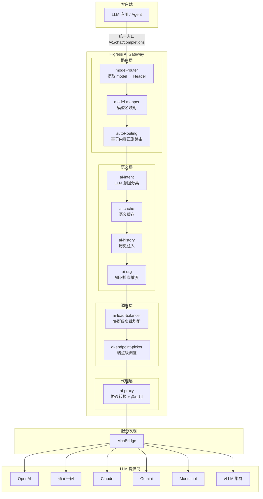
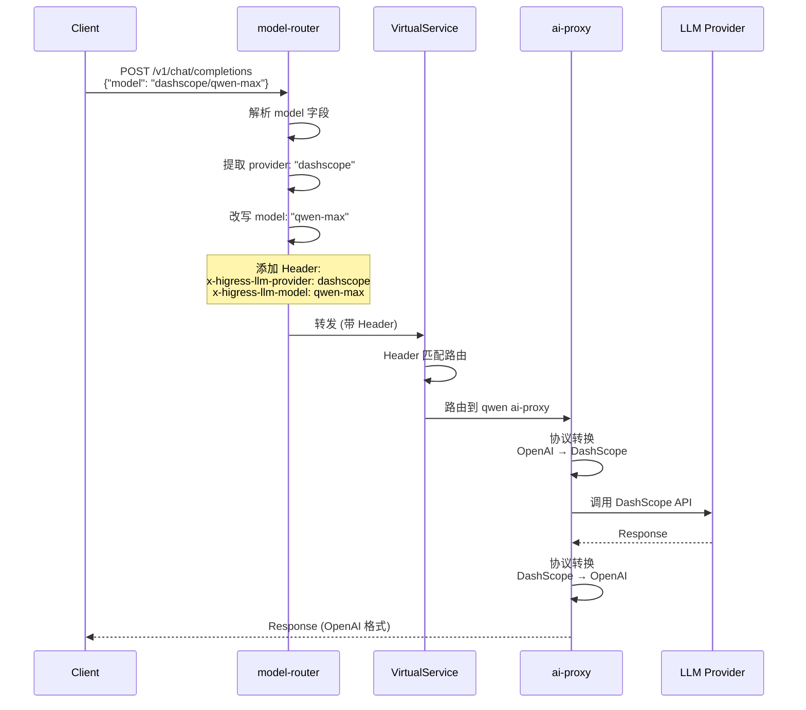
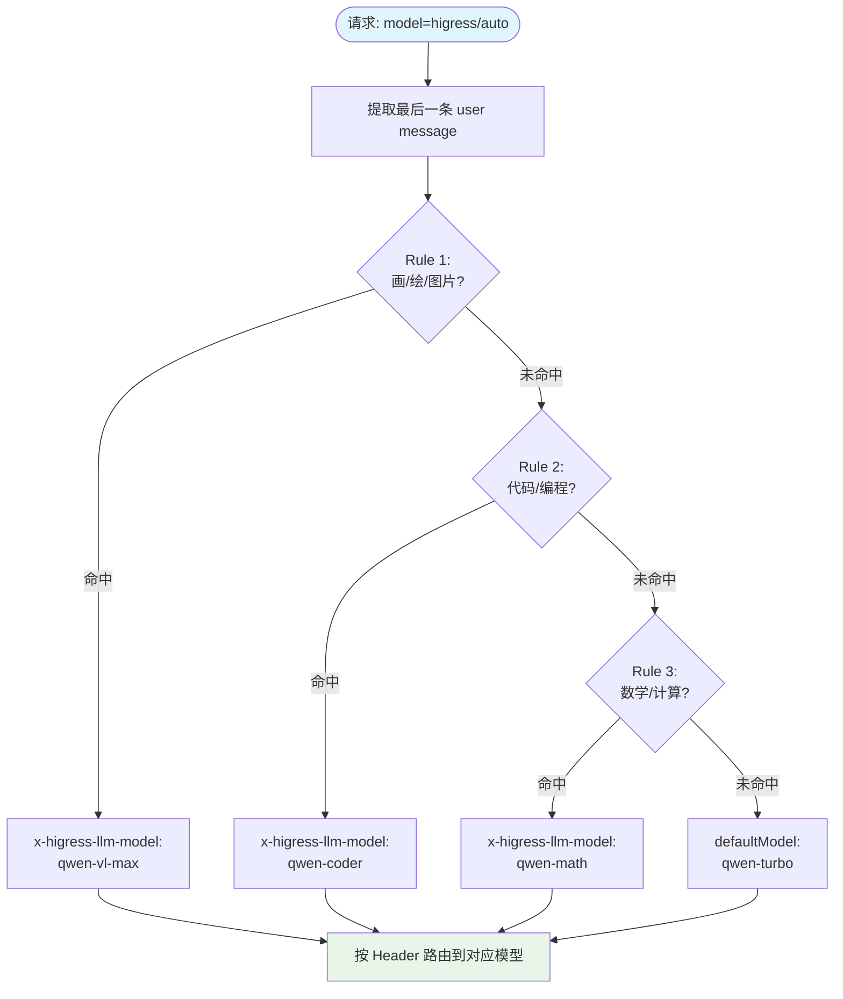
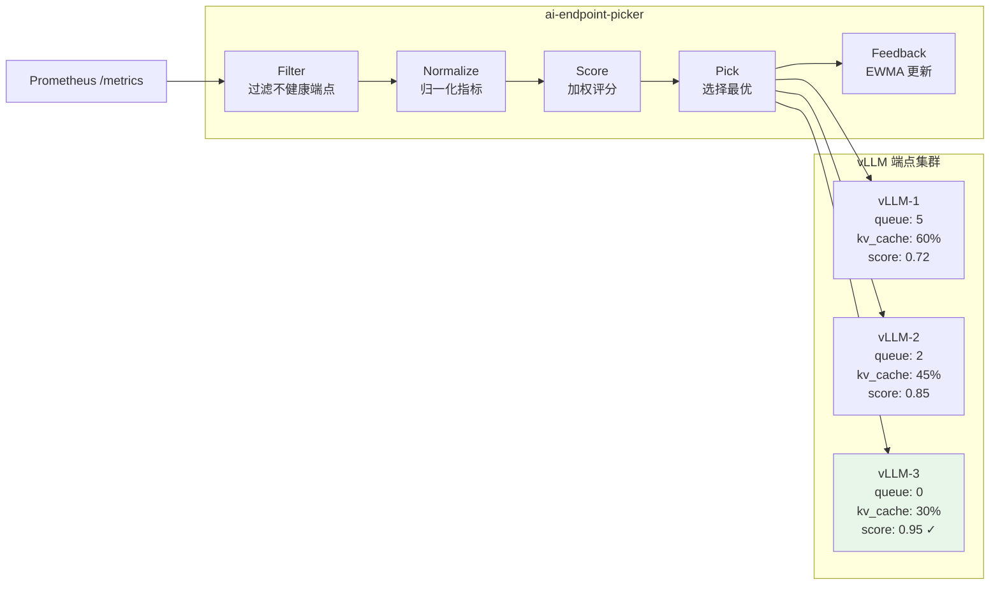
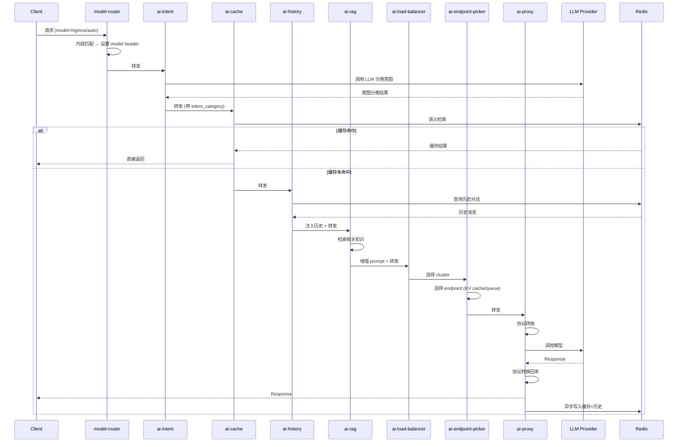

# 03 — LLM / AI 路由

> Higress 在 AI 网关方向提供了业界最完整的开源路由能力，覆盖模型路由、语义路由、端点调度、协议转换、缓存加速、历史注入、RAG 增强全链路。

---


## 架构总览



## model-router 路由流程



## autoRouting 内容路由流程



## ai-endpoint-picker 端点调度流程



## AI 插件链执行流程




## 1. 模型参数路由 — `model-router`

从 LLM 请求体中提取 `model` 参数，写入 HTTP Header 驱动后续路由。

### 1.1 基础配置

```yaml
# WasmPlugin 配置
modelToHeader: x-higress-llm-model
```

**工作流程**：
```
请求体 {"model": "qwen-long", ...}
    ↓ model-router 插件
请求头 x-higress-llm-model: qwen-long
    ↓ 控制面 VirtualService header match
路由到 qwen-long 对应的后端
```

### 1.2 Provider 提取

当 model 参数使用 `provider/model` 格式时：

```yaml
addProviderHeader: x-higress-llm-provider
keepOriginalModelName: false   # 默认 false，会改写 model 字段
```

**示例**：
```
原始请求体: {"model": "dashscope/qwen-long"}
    ↓ 处理后
请求头: x-higress-llm-provider: dashscope
请求体: {"model": "qwen-long"}    # model 字段被改写
```

设置 `keepOriginalModelName: true` 可保留原始 model 字段不变（用于 `MiniMax/MiniMax-M2.7` 这类模型名本身包含 `/` 的场景）。

### 1.3 自动路由（基于消息内容）

```yaml
autoRouting:
  enable: true
  defaultModel: "qwen-turbo"
  rules:
    - pattern: "(?i)(画|绘|生成图|图片|image|draw|paint)"
      model: "qwen-vl-max"
    - pattern: "(?i)(代码|编程|code|program|function|debug)"
      model: "qwen-coder"
    - pattern: "(?i)(翻译|translate|translation)"
      model: "qwen-turbo"
    - pattern: "(?i)(数学|计算|math|calculate)"
      model: "qwen-math"
```

**触发条件**：请求体 `model` 字段值为 `higress/auto`。

**匹配流程**：
1. 检测 `model == "higress/auto"` → 触发自动路由
2. 提取 `messages` 数组中最后一个 `role: "user"` 的消息内容
3. 按规则顺序依次正则匹配
4. 命中 → 设置 `x-higress-llm-model` Header
5. 未命中 → 使用 `defaultModel`

**支持的消息格式**：
- 字符串格式：`{"content": "用户消息"}`
- 多模态数组：`{"content": [{"type": "text", "text": "..."}, {"type": "image_url", ...}]}`
  - 数组格式提取最后一个 `type: "text"` 的内容进行匹配

**源码位置**：`plugins/wasm-go/extensions/model-router/`

---

## 2. 模型名映射 — `model-mapper`

在请求到达模型提供商之前，将模型名转换为实际目标模型。

### 2.1 配置

```yaml
modelMapping:
  'gpt-4': 'qwen-max'              # 精确匹配
  'gpt-4-*': 'qwen-max'            # 前缀匹配
  '*': 'qwen-turbo'                # 通配兜底
  '~gpt(.*)': 'openai/gpt$1'       # 正则匹配（~ 前缀）
```

### 2.2 匹配优先级

```
1. 精确匹配 (exact)
2. 前缀匹配 (prefix, 支持 glob)
3. 正则匹配 (regex, ~ 前缀)
4. 通配兜底 (wildcard, *)
```

### 2.3 典型场景

| 需求 | 配置 |
|------|------|
| 统一 OpenAI 接口到通义千问 | `'gpt-4': 'qwen-max'` |
| 按模型族路由 | `'gpt-3-*': 'qwen-turbo'` |
| 保留原始参数透传 | `keepOriginal: true` |

**源码位置**：`plugins/wasm-go/extensions/model-mapper/`

---

## 3. 统一 LLM 代理 — `ai-proxy`

单一插件对接 30+ 模型提供商，实现协议自动转换。

### 3.1 支持的提供商

OpenAI, Azure OpenAI, Anthropic Claude, Google Gemini, Moonshot, 通义千问 (DashScope), 百度文心 (Qianfan), 讯飞星火, 腾讯混元, MiniMax, DeepSeek, Cohere, Mistral, Ollama, ...

### 3.2 核心配置

```yaml
provider:
  type: qwen                          # 提供商类型
  apiTokens: ["sk-xxx", "sk-yyy"]     # 多 token 轮询
  modelMapping:
    'gpt-4': 'qwen-max'
  protocol: openai                    # openai | original
  failover:
    enabled: true
    failureThreshold: 3               # 连续失败 3 次摘除
    healthCheckInterval: 10           # 健康检测间隔（秒）
    healthCheckModel: "qwen-turbo"    # 健康检测模型
    cooldownDuration: 60              # 冷却时间（秒）
  retryOnFailure: true                # 请求失败立即重试
```

### 3.3 Token 高可用

- 多个 `apiTokens` 随机选择
- 某个 token 连续失败 `failureThreshold` 次 → 移出可用列表
- 健康检测通过或冷却时间到期 → 重新加入
- 实现 token 级别的故障转移

### 3.4 协议自动转换

| 入站协议 | 出站转换 |
|---------|---------|
| OpenAI `/v1/chat/completions` | 自动转换为目标厂商原生协议 |
| OpenAI `/v1/embeddings` | 目标厂商 embedding 协议 |
| OpenAI `/v1/images/generations` | 目标厂商图片生成协议 |
| Claude `/v1/messages` | 目标厂商 chat 协议 |

### 3.5 上下文管理

```yaml
context:
  file: "/path/to/system-prompt.txt"    # 系统提示词文件
contextCleanupCommands:                   # 清理命令
  - "strip_prefix:system:"
```

**源码位置**：`plugins/wasm-go/extensions/ai-proxy/provider/`

---

## 4. 推理端点调度 — `ai-endpoint-picker`

在单个 upstream cluster 内做端点级调度，感知 KV cache、prefix cache、LoRA 亲和。

### 4.1 配置

```yaml
weights:
  queue: 2            # 队列深度权重
  kvCache: 2          # KV cache 利用率权重
  prefixCache: 3      # 前缀缓存匹配权重
  loraAffinity: 0     # LoRA 亲和权重
  inflight: 1         # 并发请求数权重
  failure: 0          # 失败率权重

prefix:
  toolMode: identity  # identity | none | full
  maxBlocks: 32
  blockSizeTokens: 1024
  maxCacheBlocksPerEndpoint: 31250
```

### 4.2 调度流程

```
Filter → Normalize → Score → Pick → Feedback
```

1. **Filter**：过滤不健康的端点
2. **Normalize**：归一化各维度指标
3. **Score**：加权评分
4. **Pick**：选择最高分端点
5. **Feedback**：EWMA 指数加权移动平均反馈（TTFT/延迟/失败率）

### 4.3 Prefix Cache 近似匹配

- 基于 canonical JSON 的语义 segment 构建 LRU
- 评分公式：`0.75 × matched/total + 0.25 × min(matched/8192, 1)²`
- 支持工具调用、多轮对话、系统提示的语义前缀

### 4.4 数据来源

- 读取每个端点的 Prometheus `/metrics`
- 关键指标：`vllm:kv_cache_usage_perc`、队列深度、LoRA 信息

**源码位置**：`plugins/wasm-go/extensions/ai-endpoint-picker/`

---

## 5. 集群级负载均衡 — `ai-load-balancer`

在多个 upstream cluster 间做负载均衡。

### 5.1 Endpoint 级调度

```yaml
lb_type: endpoint
endpoint_lb_policy: global_least_request  # Redis 全局最小请求数
# 或
endpoint_lb_policy: prefix_cache          # KV cache 前缀匹配
# 或
endpoint_lb_policy: endpoint_metrics       # 基于 Prometheus 指标
```

### 5.2 Cluster 级调度

```yaml
lb_type: cluster
cluster_lb_policy: cluster_metrics       # 基于集群指标
# 或
cluster_lb_policy: cluster_hash          # FNV-1a 一致性哈希
```

**源码位置**：`plugins/wasm-go/extensions/ai-load-balancer/`

---

## 6. 语义/意图路由 — `ai-intent`

调用 LLM 对用户输入做意图分类，按分类路由到不同后端。

### 6.1 配置

```yaml
intentions:
  - name: "金融"
    description: "金融相关的问题，如投资、理财、股票等"
  - name: "电商"
    description: "电商相关的问题，如购物、物流、退换货等"
  - name: "法律"
    description: "法律相关的问题，如合同、法规、诉讼等"
model:
  provider: "qwen"
  apiToken: "sk-xxx"
  model: "qwen-turbo"
```

### 6.2 工作流程

```
用户请求 → ai-intent 插件 → 调用 LLM 分类 → 设置 intent_category 属性
    ↓
下游 ai-proxy 根据 intent_category 选择不同模型/提供商
```

### 6.3 典型场景

| 意图分类 | 路由目标 |
|---------|---------|
| 金融 | 金融领域专用模型 |
| 电商 | 电商知识库 + RAG |
| 法律 | 法律大模型 |
| 通用 | 通用基础模型 |

**源码位置**：`plugins/wasm-go/extensions/ai-intent/`

---

## 7. Prompt 模板路由 — `ai-prompt-template`

```yaml
templates:
  - name: "code-review"
    template: |
      你是一个代码审查专家。请审查以下 {{language}} 代码：
      ```
      {{code}}
      ```
  - name: "translate"
    template: |
      请将以下文本翻译为 {{target_language}}：
      {{text}}
```

不同模板可路由到不同模型（配合 model-router）。

**源码位置**：`plugins/wasm-go/extensions/ai-prompt-template/`

---

## 8. Prompt 装饰路由 — `ai-prompt-decorator`

```yaml
decorators:
  - type: prepend
    content: "你是一个专业的客服助手。"
  - type: replace
    pattern: "敏感词"
    replacement: "***"
```

支持前置/追加系统消息 + 正则/字面量内容替换。

**源码位置**：`plugins/wasm-go/extensions/ai-prompt-decorator/`

---

## 9. AI 语义缓存路由 — `ai-cache`

```yaml
embedding:
  provider: "dashscope"
  model: "text-embedding-v1"
vector_db:
  type: "milvus"
  url: "http://milvus:19530"
redis:
  url: "redis://redis:6379"
cacheKeyStrategy: "lastQuestion"   # lastQuestion | allQuestions | disabled
```

**行为语义**：
- 语义相似问题命中缓存 → 直接返回，不调用模型
- Header `x-higress-skip-ai-cache: on` → 跳过缓存

**源码位置**：`plugins/wasm-go/extensions/ai-cache/`

---

## 10. 对话历史注入 — `ai-history`

```yaml
redis:
  url: "redis://redis:6379"
identityKey: "Authorization"       # 用户身份来源
maxHistoryLength: 10               # 最大历史轮数
```

**行为语义**：
- 按用户（`Authorization` / `X-Mse-Consumer`）存储对话历史
- 自动注入到下一次请求的 messages 上下文

**源码位置**：`plugins/wasm-go/extensions/ai-history/`

---

## 11. AI 代理路由 — `ai-agent`

```yaml
llm:
  provider: "qwen"
  model: "qwen-max"
  apiToken: "sk-xxx"
tools:
  - name: "weather"
    description: "获取天气信息"
    openapi: "http://weather-api/openapi.json"
maxIterations: 5
maxExecutionTime: 30000            # 毫秒
```

**行为语义**：
- ReAct 模式：LLM 决策 → 调用工具 → 观察结果 → 继续推理
- 支持多轮对话 + 流式响应

**源码位置**：`plugins/wasm-go/extensions/ai-agent/`

---

## 12. RAG / 搜索增强路由

| 插件 | 能力 |
|------|------|
| `ai-rag` | 向量数据库 RAG，检索相关文档注入 prompt |
| `ai-search` | 搜索引擎增强，搜索结果注入 prompt |

**源码位置**：`plugins/wasm-go/extensions/ai-rag/`, `plugins/wasm-go/extensions/ai-search/`

---

## AI 路由策略组合示例

```
┌───────────────────────────────────────────────────────────┐
│                    请求入口                                 │
│              /v1/chat/completions                          │
└───────────────────────┬───────────────────────────────────┘
                        ↓
┌───────────────────────────────────────────────────────────┐
│            ① model-router                                  │
│    model: "higress/auto" → 分析内容 → x-higress-llm-model │
└───────────────────────┬───────────────────────────────────┘
                        ↓
┌───────────────────────────────────────────────────────────┐
│            ② ai-intent                                     │
│    意图分类 → intent_category: 金融/电商/法律               │
└───────────────────────┬───────────────────────────────────┘
                        ↓
┌───────────────────────────────────────────────────────────┐
│            ③ ai-cache                                      │
│    语义缓存命中 → 直接返回                                   │
│    未命中 → 继续                                           │
└───────────────────────┬───────────────────────────────────┘
                        ↓
┌───────────────────────────────────────────────────────────┐
│            ④ ai-history                                    │
│    注入用户历史对话上下文                                    │
└───────────────────────┬───────────────────────────────────┘
                        ↓
┌───────────────────────────────────────────────────────────┐
│            ⑤ ai-rag / ai-search                            │
│    检索相关文档 → 注入 prompt                               │
└───────────────────────┬───────────────────────────────────┘
                        ↓
┌───────────────────────────────────────────────────────────┐
│            ⑥ ai-load-balancer                              │
│    选择最优 cluster → ai-endpoint-picker                   │
│    选择最优 endpoint (KV cache / prefix / queue)           │
└───────────────────────┬───────────────────────────────────┘
                        ↓
┌───────────────────────────────────────────────────────────┐
│            ⑦ ai-proxy                                      │
│    协议转换 → 转发到目标提供商                               │
│    failover + retry → 高可用                               │
└───────────────────────────────────────────────────────────┘
```
