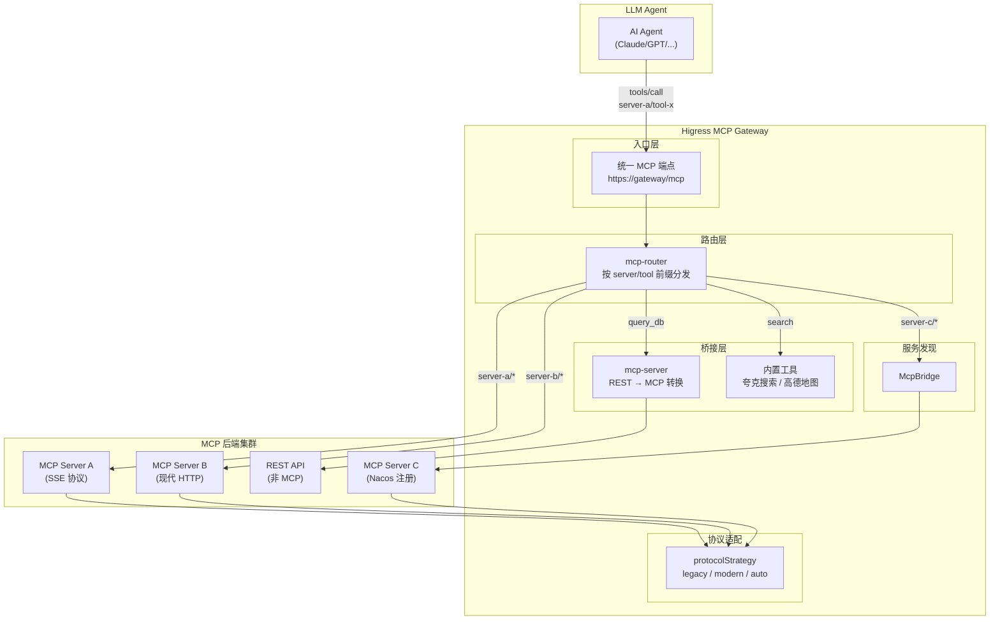
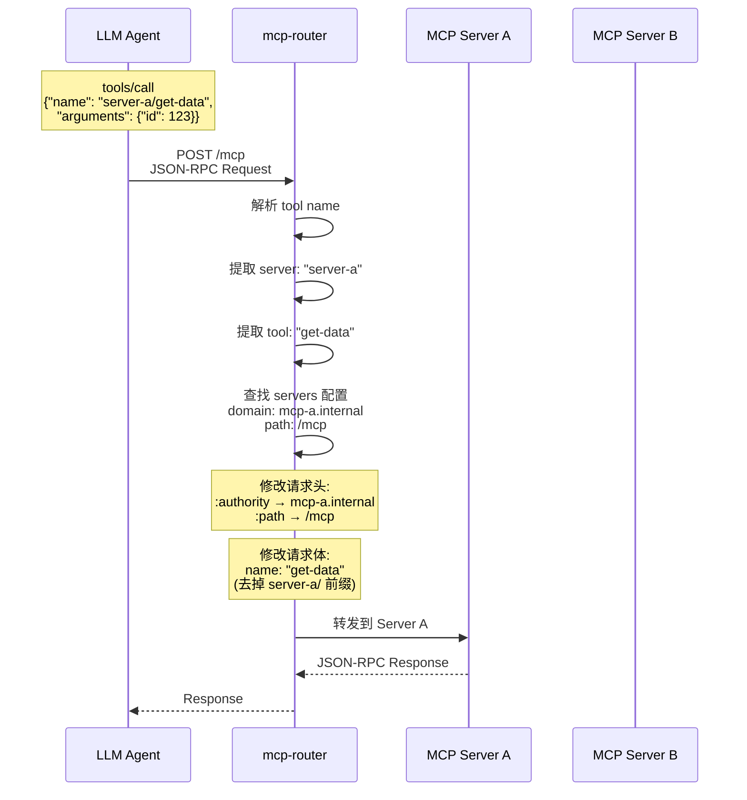
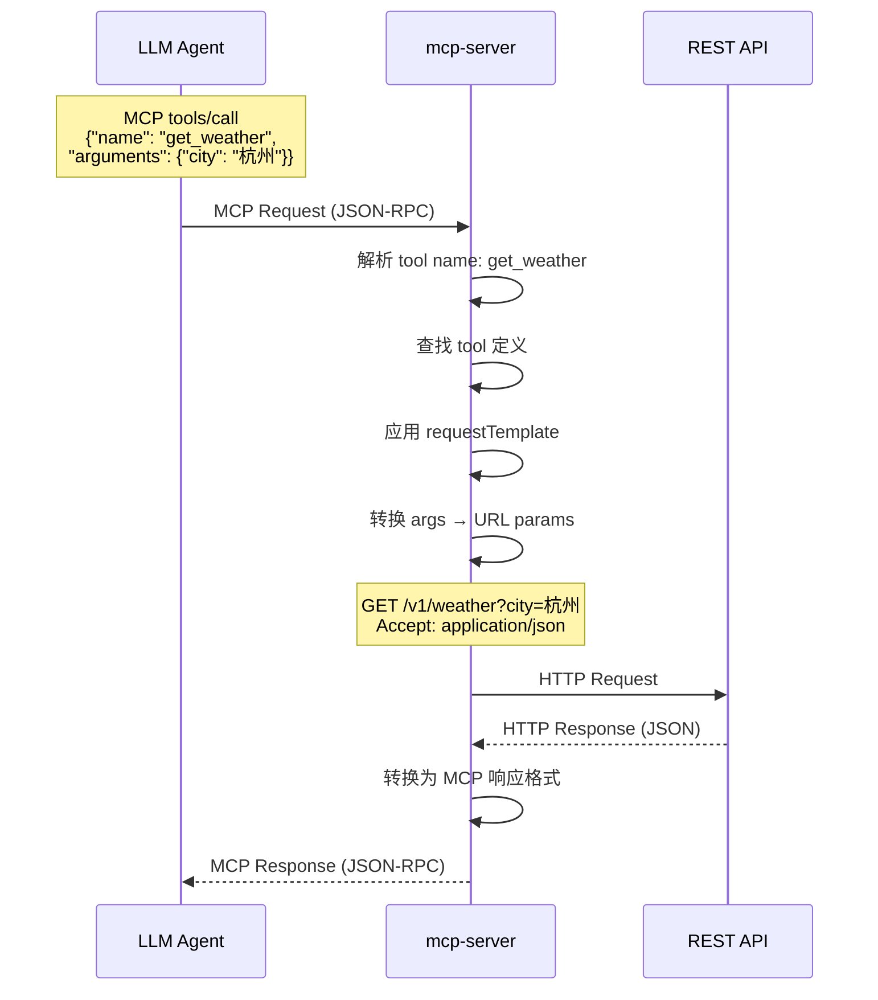
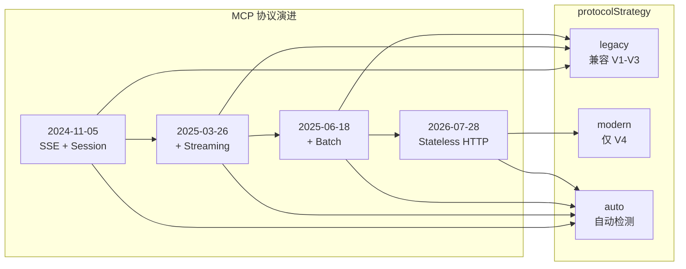
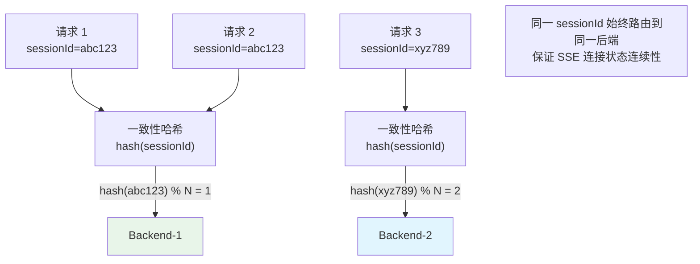

# 04 — MCP 路由

> Higress 在 MCP（Model Context Protocol）方向提供了完整的路由、聚合、协议适配能力，支持统一 MCP 端点、REST-to-MCP 桥接、多协议版本兼容。

---


## 架构总览



## mcp-router 工具分发流程



## REST-to-MCP 桥接流程



## MCP 协议版本兼容



## MCP SSE 有状态路由




## 1. MCP 工具路由 — `mcp-router`

将统一的 MCP 端点按 `server-name/tool-name` 前缀分发到不同的后端 MCP 服务器。

### 1.1 核心配置

```yaml
servers:
  - name: random-user-server
    domain: mcp.example.com
    path: /mcp-servers/mcp-random-user-server
  - name: rest-amap-server
    domain: mcp.example.com
    path: /mcp-servers/mcp-rest-amap-server
  - name: weather-server
    domain: weather.internal.svc.cluster.local
    path: /mcp
```

### 1.2 路由流程

```
原始请求:
{
  "jsonrpc": "2.0",
  "id": 2,
  "method": "tools/call",
  "params": {
    "name": "rest-amap-server/get-weather",
    "arguments": {"location": "New York"}
  }
}

    ↓ mcp-router 插件处理

1. 解析 tool name → server: "rest-amap-server", tool: "get-weather"
2. 查找 servers 配置 → domain: mcp.example.com, path: /mcp-servers/mcp-rest-amap-server
3. 修改请求头:
   - :authority → mcp.example.com
   - :path → /mcp-servers/mcp-rest-amap-server
4. 修改请求体:
   - params.name → "get-weather"（去掉 server 前缀）
5. 重新路由到目标后端
```

### 1.3 行为语义

| 场景 | 行为 |
|------|------|
| tool name 包含 `/` 前缀 | 按前缀匹配 server，重写路由 |
| tool name 不包含 `/` | 不做任何处理，请求正常流转 |
| server name 未配置 | 不做处理（fail open） |

### 1.4 典型用途

- **统一 MCP 入口**：LLM Agent 只需对接一个 MCP 端点，由 mcp-router 分发
- **多租户隔离**：不同 server 对应不同租户的 MCP 后端
- **渐进式迁移**：新 MCP 服务器逐步替换旧的，通过路由前缀切换

**源码位置**：`plugins/wasm-go/extensions/mcp-router/`

---

## 2. 网关内置 MCP 服务器 — `mcp-server`

在网关内部直接暴露 MCP 工具，无需独立后端。

### 2.1 内置工具集

| 工具集 | 说明 |
|--------|------|
| 夸克搜索 | 网页搜索、知识检索 |
| 高德地图 | 地理编码、路线规划、天气查询 |

### 2.2 REST-to-MCP 桥接

将已有的 REST API 包装为 MCP 工具：

```yaml
server:
  name: weather-demo
  type: rest
  version: "1.0.0"

tools:
  - name: get_weather
    description: "获取指定城市的天气信息"
    args:
      - name: location
        type: string
        required: true
        description: "城市名称"
      - name: unit
        type: string
        required: false
        description: "温度单位：celsius 或 fahrenheit"
    requestTemplate:
      url: "http://weather-api.internal/v1/weather"
      method: GET
      argsToUrlParam: true
      headers:
        Accept: "application/json"
```

### 2.3 REST-to-MCP 工作流程

```
MCP 请求:
{
  "jsonrpc": "2.0",
  "id": 1,
  "method": "tools/call",
  "params": {
    "name": "get_weather",
    "arguments": {"location": "杭州", "unit": "celsius"}
  }
}

    ↓ mcp-server 插件转换

REST 请求:
GET http://weather-api.internal/v1/weather?location=杭州&unit=celsius
Accept: application/json
```

### 2.4 协议版本兼容

`mcp-server` 支持多种 MCP 协议版本，通过 `protocolStrategy` 控制：

| 策略 | 说明 |
|------|------|
| `legacy` | 兼容 2024-11-05 / 2025-03-26 / 2025-06-18 协议，支持 initialize / session / SSE |
| `modern` | MCP 2026-07-28 协议，无状态 HTTP，`_meta`，strict content-type |
| `auto` | 自动检测上游协议版本 |

### 2.5 Modern MCP 协议要求（2026-07-28）

- 无状态 HTTP（无 session）
- 严格 Content-Type / Accept / Origin 校验
- 单消息边界（single-message boundary）
- `_meta` 字段透传

**源码位置**：`plugins/wasm-go/extensions/mcp-server/`

---

## 3. MCP 路由规划服务 — `mcp-route-planning`

`plugins/wasm-go/mcp-servers/mcp-route-planning/` 提供 MCP 协议的路由规划能力：

- 分析工具列表
- 规划最优调用路径
- 支持多步工具编排

---

## 4. McpBridge — MCP 服务发现

McpBridge CRD 统一了 MCP 后端的服务发现：

```yaml
apiVersion: networking.higress.io/v1
kind: McpBridge
metadata:
  name: mcp-registry
spec:
  registries:
    - name: mcp-nacos
      type: nacos
      domain: nacos.svc.cluster.local
      port: 8848
    - name: mcp-consul
      type: consul
      domain: consul.svc.cluster.local
      port: 8500
    - name: mcp-dns
      type: dns
      domain: mcp.example.com
      port: 443
```

### 4.1 支持的注册中心

| 类型 | 说明 |
|------|------|
| `nacos` | Nacos 服务发现 |
| `consul` | Consul 服务发现 |
| `eureka` | Eureka 服务发现 |
| `zookeeper` | ZooKeeper 服务发现 |
| `dns` | DNS 解析 |
| `mcp` | MCP 协议原生注册 |

### 4.2 路由引用

Ingress 通过 `higress.io/destination` 引用 McpBridge 中注册的 MCP 后端：

```yaml
metadata:
  annotations:
    higress.io/destination: "mcp-weather-service.mcp-registry.mcp"
```

---

## 5. MCP SSE 有状态路由

MCP SSE（Server-Sent Events）连接需要保持有状态——同一 session 的请求必须路由到同一后端。

### 5.1 配置

```yaml
metadata:
  annotations:
    higress.io/mcp-sse-stateful-param-name: "sessionId"
```

### 5.2 行为语义

- 从请求中提取 `sessionId` 参数
- 基于 sessionId 做一致性哈希
- 同一 sessionId 的请求始终路由到同一后端
- 后端宕机时，自动切换到新后端（SSE 重连）

---

## 6. MCP 路由架构总览

```
┌──────────────────────────────────────────────────────────┐
│                   MCP Client (LLM Agent)                  │
│              统一端点: https://gateway/mcp                │
└─────────────────────────┬────────────────────────────────┘
                          ↓
┌──────────────────────────────────────────────────────────┐
│                   Higress Gateway                         │
│                                                           │
│  ┌────────────────────────────────────────────────────┐  │
│  │              mcp-router                             │  │
│  │  tools/call: server-a/tool-x → server-a backend    │  │
│  │  tools/call: server-b/tool-y → server-b backend    │  │
│  └──────────────────────┬─────────────────────────────┘  │
│                          ↓                                 │
│  ┌─────────────┐  ┌─────────────┐  ┌─────────────────┐  │
│  │ mcp-server  │  │ 后端 MCP-A  │  │ 后端 MCP-B      │  │
│  │ (内置工具)   │  │ (独立服务)   │  │ (REST→MCP)     │  │
│  │ - 夸克搜索   │  │ SSE/HTTP    │  │ REST API        │  │
│  │ - 高德地图   │  │             │  │                 │  │
│  └─────────────┘  └─────────────┘  └─────────────────┘  │
│                                                           │
│  ┌────────────────────────────────────────────────────┐  │
│  │              McpBridge                              │  │
│  │  Nacos │ Consul │ Eureka │ ZK │ DNS │ MCP         │  │
│  └────────────────────────────────────────────────────┘  │
└──────────────────────────────────────────────────────────┘
```

---

## 7. MCP 路由配置示例

### 7.1 统一 MCP 聚合端点

```yaml
# WasmPlugin
apiVersion: extensions.higress.io/v1alpha1
kind: WasmPlugin
metadata:
  name: mcp-aggregator
spec:
  selector:
    ingress:
      - default/mcp-ingress
  url: oci://.../mcp-router:1.0.0
  pluginConfig:
    servers:
      - name: search
        domain: search.mcp.svc.cluster.local
        path: /mcp
      - name: weather
        domain: weather.mcp.svc.cluster.local
        path: /mcp
      - name: code-exec
        domain: code-exec.mcp.svc.cluster.local
        path: /mcp
```

### 7.2 REST-to-MCP 桥接

```yaml
apiVersion: extensions.higress.io/v1alpha1
kind: WasmPlugin
metadata:
  name: rest-to-mcp
spec:
  selector:
    ingress:
      - default/mcp-bridge
  url: oci://.../mcp-server:1.0.0
  pluginConfig:
    server:
      name: api-bridge
      type: rest
      version: "1.0.0"
    tools:
      - name: get_user
        description: "获取用户信息"
        args:
          - name: user_id
            type: string
            required: true
        requestTemplate:
          url: "http://user-service.default.svc.cluster.local/api/users"
          method: GET
          argsToUrlParam: true
      - name: create_order
        description: "创建订单"
        args:
          - name: product_id
            type: string
            required: true
          - name: quantity
            type: integer
            required: true
        requestTemplate:
          url: "http://order-service.default.svc.cluster.local/api/orders"
          method: POST
          bodyTemplate: |
            {"productId": "{{product_id}}", "quantity": {{quantity}}}
```

---

## MCP 路由策略速查

| 策略 | 插件/CRD | 核心能力 |
|------|---------|---------|
| 工具路由 | `mcp-router` | 按 `server/tool` 前缀分发 |
| 内置工具 | `mcp-server` | 网关内部暴露 MCP 工具 |
| REST-to-MCP | `mcp-server` (type: rest) | REST API 包装为 MCP 工具 |
| 服务发现 | `McpBridge` CRD | Nacos/Consul/Eureka/ZK/DNS/MCP |
| SSE 有状态 | annotation | 按 sessionId 做会话亲和 |
| 协议适配 | `protocolStrategy` | legacy/modern/auto 协议版本 |
