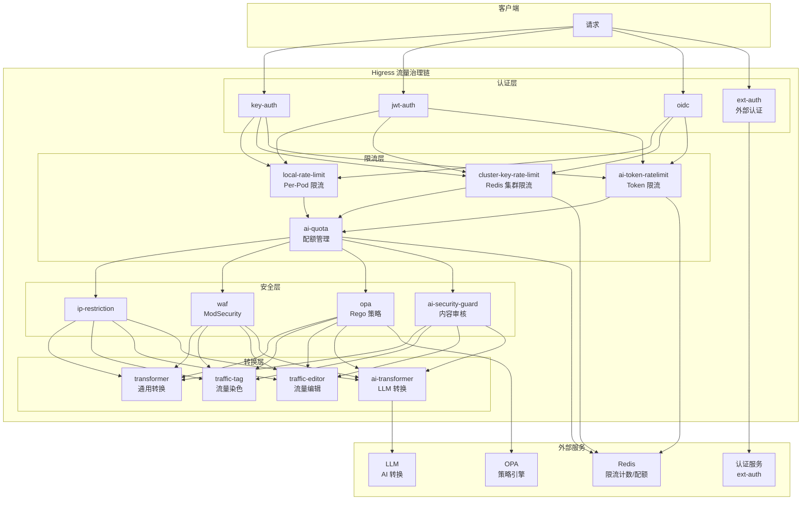
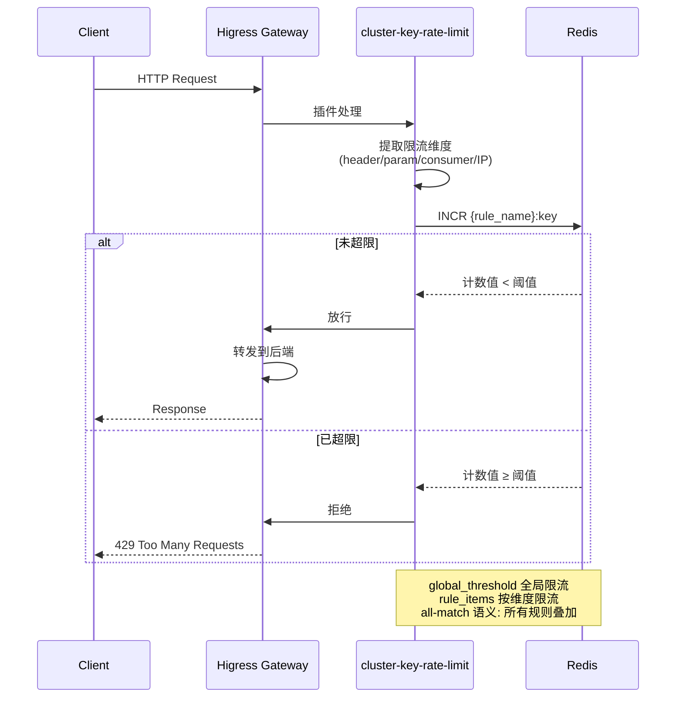
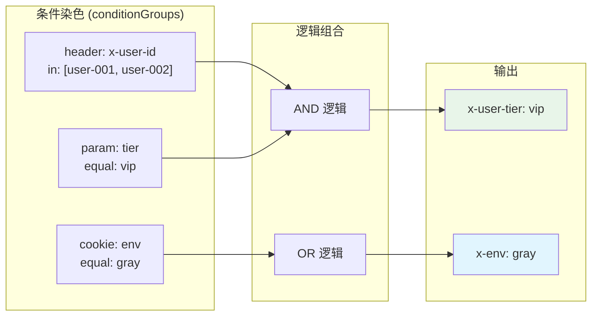
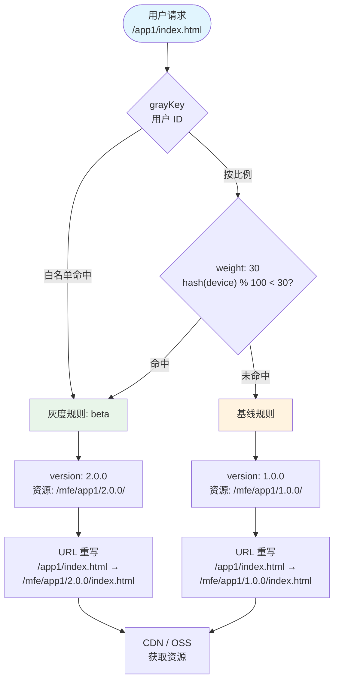

# 05 — 流量治理策略

> 在路由决策完成之后，Higress 提供完整的流量治理策略链：限流、配额、认证、安全、转换、染色，实现策略即代码的流量管控。

---


## 架构总览



## 限流执行流程



## 认证决策流程

```mermaid
flowchart TD
    Req(["请求到达"]) --> Auth{"认证插件"}

    Auth -->|"key-auth"| Key{"API Key<br/>匹配 consumer?"}
    Auth -->|"jwt-auth"| JWT{"JWT 验证<br/>有效?"}
    Auth -->|"oidc"| OIDC{"OIDC Token<br/>有效?"}
    Auth -->|"ext-auth"| Ext["调用外部<br/>认证服务"]

    Key -->|"是"| Consumer1["consumer: app-1"]
    Key -->|"否"| Deny1["401 Unauthorized"]
    JWT -->|"是"| Consumer2["consumer: user-1"]
    JWT -->|"否"| Deny2["401 Unauthorized"]
    OIDC -->|"是"| Consumer3["consumer: user-2"]
    OIDC -->|"否"| Deny3["401 Unauthorized"]
    Ext -->|"通过"| Consumer4["consumer: service-a"]
    Ext -->|"拒绝"| Deny4["403 Forbidden"]

    Consumer1 & Consumer2 & Consumer3 & Consumer4 --> Next["继续下游处理<br/>限流/配额/路由"]

    style Req fill:#e1f5fe
    style Next fill:#e8f5e9
    style Deny1 & Deny2 & Deny3 & Deny4 fill:#ffebee
```

## 流量染色策略



## 前端灰度流程



## WAF / OPA 安全决策

```mermaid
flowchart TD
    Req(["请求"]) --> IP{"IP 限制<br/>allow/deny?"}
    IP -->|"拒绝"| Block1["403 Forbidden"]
    IP -->|"允许"| WAFCheck{"WAF 规则<br/>ModSecurity"}

    WAFCheck -->|"命中规则"| Block2["403 Forbidden<br/>攻击拦截"]
    WAFCheck -->|"通过"| OPACheck{"OPA 策略<br/>Rego"}

    OPACheck -->|"deny"| Block3["403 Forbidden<br/>策略拒绝"]
    OPACheck -->|"allow"| ContentCheck{"内容安全<br/>ai-security-guard"}

    ContentCheck -->|"违规"| Mask["脱敏处理<br/>或拒绝"]
    ContentCheck -->|"合规"| Pass["放行"]

    style Req fill:#e1f5fe
    style Pass fill:#e8f5e9
    style Block1 & Block2 & Block3 & Mask fill:#ffebee
```


## 1. 限流策略

### 1.1 本地限流（Per-Pod）

通过 Ingress annotation 实现单 Pod 维度的限流：

```yaml
metadata:
  annotations:
    higress.io/local-rate-limit-enabled: "true"
    higress.io/local-rate-limit-rps: "100"
    higress.io/local-rate-limit-burst: "200"
```

**行为语义**：每个 Pod 独立计数，100 QPS，突发 200。

### 1.2 集群限流 — `cluster-key-rate-limit`

基于 Redis 的全集群分布式限流：

```yaml
rule_items:
  - limit_by_header: "x-api-key"
    limit_by_per_header: "key"
    limit_delta: 1000
    limit_period: per_minute
  - limit_by_consumer: ""
    limit_by_per_ip:
      remote_address: true
    limit_delta: 100
    limit_period: per_second
global_threshold: 10000
global_period: per_minute
```

**核心能力**：

| 能力 | 说明 |
|------|------|
| 多维度分组 | `limit_by_header` / `limit_by_param` / `limit_by_consumer` / `limit_by_cookie` / `limit_by_per_ip` |
| 多时间窗口 | `per_second` / `per_minute` / `per_hour` / `per_day` |
| 全局 + 规则 | `global_threshold`（全局兜底）+ `rule_items`（按维度细分） |
| Redis 后端 | 分布式计数器，key 格式包含 `{rule_name}` hash tag 兼容 Redis Cluster |
| All-match 语义 | 所有匹配规则叠加生效，任一触发即拒绝 |

**源码位置**：`plugins/wasm-go/extensions/cluster-key-rate-limit/`

### 1.3 AI Token 限流 — `ai-token-ratelimit`

基于 LLM token 用量的限流（而非请求数）：

```yaml
rule_items:
  - limit_by_consumer: "free-user"
    limit_delta: 10000
    limit_period: per_day
  - limit_by_consumer: "paid-user"
    limit_delta: 100000
    limit_period: per_day
global_threshold: 1000000
global_period: per_day
```

**行为语义**：
- 请求阶段检查窗口剩余 → 通过/拒绝
- 响应后累计 token 用量 → 扣减配额
- 按 consumer 身份区分配额

**局限**：请求检查 + 响应扣减 → 存在并发超额窗口，**不能宣称严格预算**。

**源码位置**：`plugins/wasm-go/extensions/ai-token-ratelimit/`

---

## 2. 配额策略 — `ai-quota`

基于 consumer 身份的固定配额管理：

```yaml
admin_path: "/quota-admin"
admin_consumer: "admin-user"
redis:
  url: "redis://redis:6379"
```

### 2.1 管理 API

| 操作 | 请求 |
|------|------|
| 查询配额 | `GET /quota-admin?consumer=free-user` |
| 刷新配额 | `POST /quota-admin/refresh?consumer=free-user` |
| 增减配额 | `POST /quota-admin/delta?consumer=free-user&delta=1000` |

### 2.2 依赖关系

- 需要 `key-auth` / `jwt-auth` 获取 consumer 身份
- 需要 `ai-statistics` 获取 token 统计信息

**源码位置**：`plugins/wasm-go/extensions/ai-quota/`

---

## 3. 认证策略

### 3.1 Key Auth — `key-auth`

```yaml
consumers:
  - name: "app-1"
    credential: "sk-app1-xxx"
  - name: "app-2"
    credential: "sk-app2-yyy"
```

### 3.2 JWT Auth — `jwt-auth`

```yaml
consumers:
  - name: "user-1"
    jwks: |
      {"keys": [...]}
```

### 3.3 OIDC — `oidc`

```yaml
issuer: "https://accounts.google.com"
clientId: "xxx"
clientSecret: "yyy"
redirectUrl: "https://app.example.com/callback"
```

### 3.4 HMAC Auth — `hmac-auth-apisix`

```yaml
consumers:
  - name: "service-a"
    accessKey: "ak-xxx"
    secretKey: "sk-yyy"
```

### 3.5 外部认证 — `ext-auth`

```yaml
http_service:
  endpoint: "http://auth-service:8080/check"
  timeout: 3000
  allowed_headers:
    - "x-user-id"
  failure_mode_allow: false       # 认证服务不可用时拒绝请求
  request_body:
    enabled: true
    max_size: 8192
```

**行为语义**：
- 支持 Envoy ext_authz 和 forward_auth 两种模式
- `failure_mode_allow: true` → 认证服务不可用时放行（高可用优先）
- `failure_mode_allow: false` → 认证服务不可用时拒绝（安全优先）
- 支持将认证结果通过 filter-state 传递为 Header

**源码位置**：`plugins/wasm-go/extensions/ext-auth/`

---

## 4. 安全策略

### 4.1 IP 限制 — `ip-restriction`

```yaml
allow:
  - "10.0.0.0/8"
  - "172.16.0.0/12"
deny:
  - "10.0.1.100"
```

### 4.2 WAF — `waf`

```yaml
ruleEngine: "modsecurity"
rules:
  - SecRule REQUEST_HEADERS:User-Agent "@contains badbot" "id:1,deny,status:403"
# 支持 OWASP CRS (Core Rule Set)
```

**源码位置**：`plugins/wasm-go/extensions/waf/`

### 4.3 OPA — `opa`

```yaml
policy: |
  package policy
  default allow = false
  allow {
    input.request.method == "GET"
    input.request.path == "/public/*"
  }
```

**源码位置**：`plugins/wasm-go/extensions/opa/`

### 4.4 AI 内容安全 — `ai-security-guard`

```yaml
provider: "aliyun"
accessKeyId: "xxx"
accessKeySecret: "yyy"
requestModerationLevel: "strict"
responseModerationLevel: "normal"
action: "block"           # block | mask
```

**行为语义**：
- 对请求/响应内容做内容安全审核
- `block` → 直接拒绝
- `mask` → 脱敏后放行
- 支持按 consumer 设置不同审核级别

### 4.5 Qwen 内容守卫 — `qwen3guard`

```yaml
model: "qwen3-guard"
apiToken: "sk-xxx"
```

### 4.6 防重放 — `replay-protection`

```yaml
timestampTolerance: 300     # 5 分钟时间戳容差
nonceCacheSize: 10000       # nonce 缓存大小
```

### 4.7 CORS — `cors`

```yaml
allowOrigins:
  - "https://app.example.com"
allowMethods:
  - "GET"
  - "POST"
allowHeaders:
  - "Content-Type"
  - "Authorization"
maxAge: 3600
```

---

## 5. 流量染色 — `traffic-tag`

根据请求内容或权重为流量打标，供下游路由决策。

### 5.1 基于条件的染色

```yaml
conditionGroups:
  - headerName: "x-user-tier"
    headerValue: "vip"
    logic: "and"
    conditions:
      - conditionType: "header"
        key: "x-user-id"
        operator: "in"
        value: ["user-001", "user-002", "user-003"]
      - conditionType: "parameter"
        key: "tier"
        operator: "equal"
        value: ["vip"]
  - headerName: "x-env"
    headerValue: "gray"
    logic: "or"
    conditions:
      - conditionType: "cookie"
        key: "env"
        operator: "equal"
        value: ["gray"]
```

### 5.2 基于权重的染色

```yaml
weightGroups:
  - headerName: "x-ab-group"
    headerValue: "A"
    weight: 50
  - headerName: "x-ab-group"
    headerValue: "B"
    weight: 50
```

### 5.3 操作符

| 操作符 | 说明 |
|--------|------|
| `equal` | 精确匹配 |
| `not_equal` | 不等匹配 |
| `prefix` | 前缀匹配 |
| `in` | 包含匹配 |
| `not_in` | 排除匹配 |
| `regex` | 正则匹配（RE2 引擎） |
| `percentage` | 百分比匹配（幂等，同一键值多次结果一致） |

**`percentage` vs `weight` 的区别**：
- `percentage`：基于 `hash(get(key)) % 100 < value`，幂等（同一请求多次匹配结果相同）
- `weight`：基于随机权重分布，同一请求可能匹配不同结果

**源码位置**：`plugins/wasm-go/extensions/traffic-tag/`

---

## 6. 流量编辑 — `traffic-editor`

低级命令集，对请求/响应做精细化编辑：

```yaml
commandSets:
  - conditions:
      - match:
          header: "x-env"
          value: "production"
    commands:
      - type: "set"
        target: "header"
        key: "x-debug"
        value: "false"
      - type: "delete"
        target: "header"
        key: "x-internal"
    disableReroute: false     # 编辑后是否重新路由
```

### 6.1 命令类型

| 命令 | 说明 |
|------|------|
| `set` | 设置值 |
| `concat` | 拼接值 |
| `copy` | 复制值 |
| `delete` | 删除字段 |
| `rename` | 重命名字段 |

**源码位置**：`plugins/wasm-go/extensions/traffic-editor/`

---

## 7. 通用转换器 — `transformer`

通用 Header / Query / Body 转换器，支持 `reroute`（转换后重新路由）：

```yaml
request:
  header:
    remove:
      - "x-internal"
    add:
      - key: "x-trace-id"
        value: "{{.Request.Header.X-Trace-Id}}"
    rename:
      - source: "x-old-header"
        target: "x-new-header"
  body:
    - action: "replace"
      path: "$.user.name"
      value: "anonymized"
reroute: true
```

**源码位置**：`plugins/wasm-go/extensions/transformer/`

---

## 8. AI 转换器 — `ai-transformer`

用 LLM 重写请求/响应：

```yaml
llm:
  provider: "qwen"
  model: "qwen-turbo"
  apiToken: "sk-xxx"
requestPrompt: |
  将请求体中的 XML 转换为 JSON 格式
responsePrompt: |
  移除响应中的所有内部注释
```

**源码位置**：`plugins/wasm-go/extensions/ai-transformer/`

---

## 9. 前端灰度 — `frontend-gray`

前端 A/B 实验 + 版本灰度 + 微前端资源路由：

```yaml
grayKey: "userId"                         # 用户 ID 来源（Cookie/Header）
baseDeployment:
  version: "1.0.0"                        # 基线版本
  backendVersion: "v1"
grayDeployments:
  - name: "beta"
    version: "2.0.0"
    backendVersion: "v2"
    weight: 30                            # 30% 流量到灰度
    enabled: true
rules:
  - name: "beta"
    grayKeyValue: ["user-001", "user-002"]  # 白名单用户
rewrite:
  indexRouting:
    "/app1": "/mfe/app1/{version}/index.html"
  fileRouting:
    "/app1/": "/mfe/app1/{version}"
```

**行为语义**：
- `{version}` 是保留字，运行时动态替换为 base/gray 版本号
- 按比例灰度使用 SHA-256 设备指纹哈希
- 支持微前端多应用版本独立管理

**源码位置**：`plugins/wasm-go/extensions/frontend-gray/`

---

## 10. 协议转换

| 插件 | 转换方向 | 说明 |
|------|---------|------|
| `ai-proxy` | OpenAI ↔ 各厂商 | LLM 协议自动转换 |
| `de-graphql` | URI → GraphQL | REST URI 参数映射为 GraphQL 查询 |
| `jsonrpc-converter` | HTTP ↔ JSON-RPC | JSON-RPC 协议转换 |
| `nginx-rewrite-compatible` | nginx rewrite → Higress | nginx rewrite 指令兼容 |
| `gw-error-format` | 任意 → 标准错误 | 统一错误响应格式 |

---

## 流量治理策略总览

| 策略类别 | 插件 | 配置面 | 核心能力 |
|---------|------|--------|---------|
| 本地限流 | annotation | Ingress | Per-Pod QPS |
| 集群限流 | `cluster-key-rate-limit` | WasmPlugin | Redis 分布式多维度限流 |
| Token 限流 | `ai-token-ratelimit` | WasmPlugin | 基于 LLM token 的限流 |
| 配额管理 | `ai-quota` | WasmPlugin | Per-consumer 配额 + 管理 API |
| 认证 | `key-auth` / `jwt-auth` / `oidc` / `hmac-auth` | WasmPlugin | Consumer 身份识别 |
| 外部认证 | `ext-auth` | WasmPlugin | 外部认证服务 |
| WAF | `waf` | WasmPlugin | ModSecurity + OWASP CRS |
| OPA | `opa` | WasmPlugin | Rego 策略 |
| 内容安全 | `ai-security-guard` / `qwen3guard` | WasmPlugin | AI 内容审核 |
| 流量染色 | `traffic-tag` | WasmPlugin | 条件/权重打标 |
| 流量编辑 | `traffic-editor` | WasmPlugin | 低级命令集编辑 |
| 通用转换 | `transformer` | WasmPlugin | Header/Query/Body 转换 + reroute |
| AI 转换 | `ai-transformer` | WasmPlugin | LLM 驱动的转换 |
| 前端灰度 | `frontend-gray` | WasmPlugin | A/B + 版本灰度 + 微前端 |
| 协议转换 | `de-graphql` / `jsonrpc-converter` | WasmPlugin | 协议桥接 |
