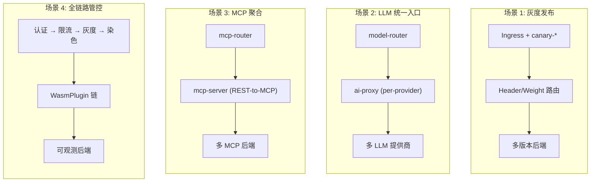
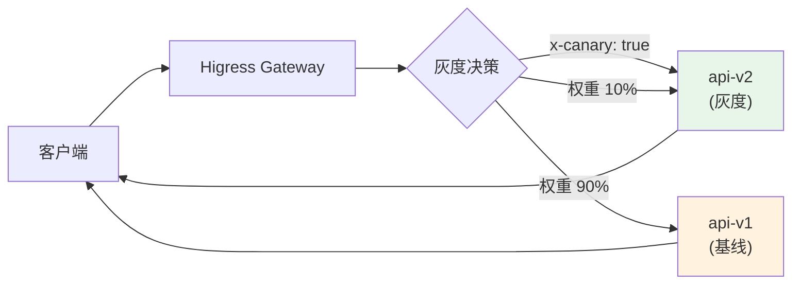
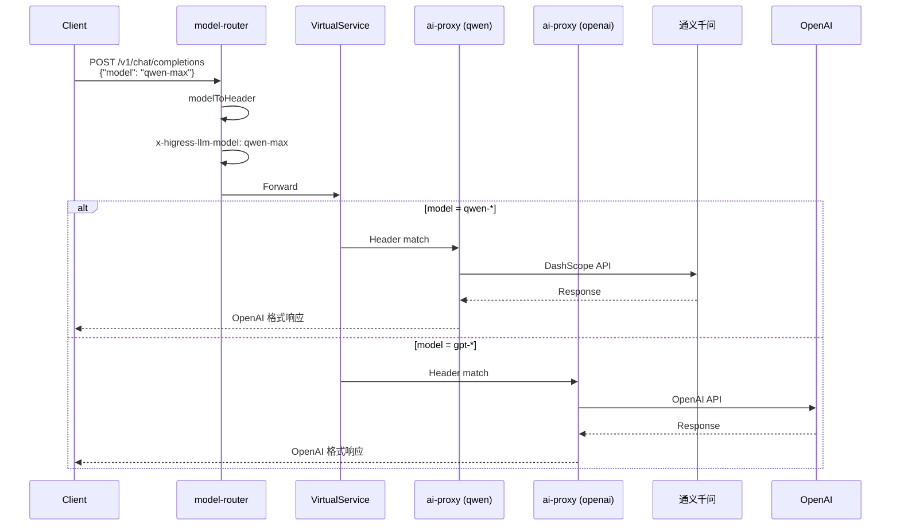
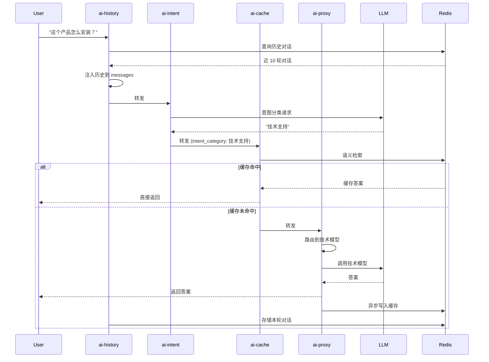
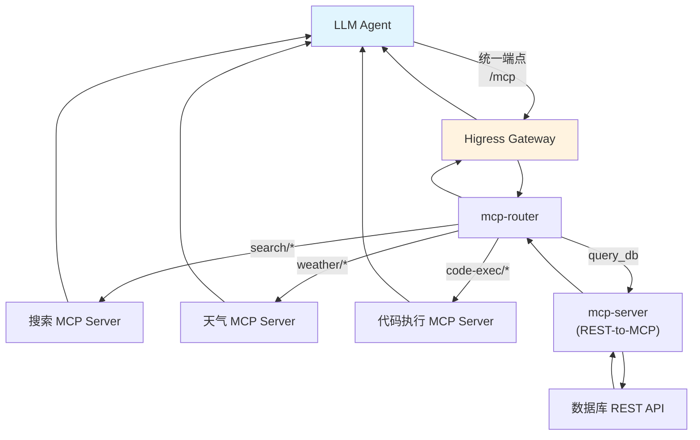
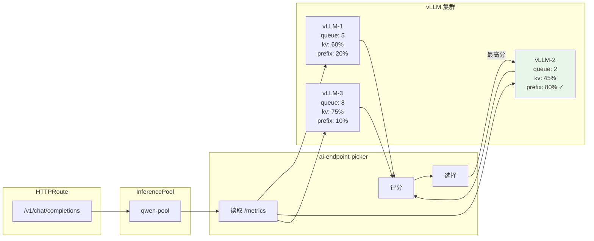
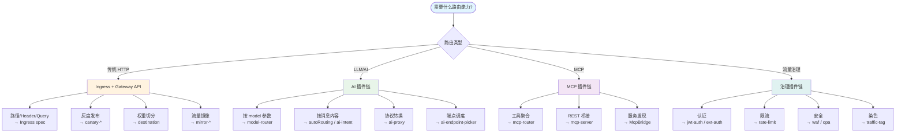

# 06 — 典型路由编排

> 本文档展示 Higress 路由策略在真实场景中的端到端编排方式，从简单到复杂逐层递进。

---


## 典型编排架构总览



## 场景 1: 灰度发布流程



## 场景 2: Per-Model LLM 路由流程



## 场景 3: 意图路由 + 缓存 + 历史



## 场景 4: MCP 统一聚合端点



## 场景 5: InferencePool 推理调度



## 场景 6: 全链路管控流程

```mermaid
flowchart TD
    Req(["请求<br/>api.example.com/api/*"]) --> IP{"IP 白名单<br/>10.0.0.0/8?"}
    IP -->|"拒绝"| Block1["403"]
    IP -->|"允许"| JWT{"JWT 认证"}
    JWT -->|"无效"| Block2["401"]
    JWT -->|"有效"| RL{"集群限流<br/>1000/min?"}
    RL -->|"超限"| Block3["429"]
    RL -->|"正常"| Tag["流量染色<br/>x-canary-trace"]
    Tag --> Canary{"灰度决策<br/>x-env: gray?"}

    Canary -->|"是"| V2["api-v2<br/>(灰度)"]
    Canary -->|"否"| Weight{"canary-weight<br/>5%?"}
    Weight -->|"命中"| V2
    Weight -->|"未命中"| V1["api-v1<br/>(基线)"]

    V1 --> Timeout["超时 10s<br/>重试 2 次"]
    V2 --> Timeout
    Timeout --> Resp["响应<br/>+ CORS 头"]

    style Req fill:#e1f5fe
    style Resp fill:#e8f5e9
    style Block1 & Block2 & Block3 fill:#ffebee
```

## 策略选择决策树




## 1. 基础 HTTP 路由 + 灰度发布

### 1.1 场景

API v2 灰度发布，10% 流量切到新版本，通过 Header 可强制指定。

### 1.2 配置

```yaml
# 基线 Ingress
apiVersion: networking.k8s.io/v1
kind: Ingress
metadata:
  name: api-v1
spec:
  rules:
    - host: api.example.com
      http:
        paths:
          - path: /api
            pathType: Prefix
            backend:
              service:
                name: api-v1
                port: 8080

---
# 灰度 Ingress
apiVersion: networking.k8s.io/v1
kind: Ingress
metadata:
  name: api-v2-canary
  annotations:
    nginx.ingress.kubernetes.io/canary: "true"
    nginx.ingress.kubernetes.io/canary-by-header: "x-canary"
    nginx.ingress.kubernetes.io/canary-by-header-value: "true"
    nginx.ingress.kubernetes.io/canary-weight: "10"
spec:
  rules:
    - host: api.example.com
      http:
        paths:
          - path: /api
            pathType: Prefix
            backend:
              service:
                name: api-v2
                port: 8080
```

### 1.3 路由流程

```
请求 → api.example.com/api/*
  ├── Header x-canary: true → 100% 到 api-v2
  └── 其他 → 10% 到 api-v2, 90% 到 api-v1
```

---

## 2. 多后端权重切分 + 服务发现

### 2.1 场景

跨 Nacos 和 K8s 的多数据中心流量切分。

### 2.2 配置

```yaml
apiVersion: networking.k8s.io/v1
kind: Ingress
metadata:
  name: multi-dc
  annotations:
    higress.io/destination: |
      40% user-service.DEFAULT-GROUP.public.nacos
      40% user-service.default.svc.cluster.local
      20% user-service.CANARY-GROUP.public.nacos
spec:
  rules:
    - host: user.example.com
      http:
        paths:
          - path: /
            pathType: Prefix
            backend:
              service:
                name: placeholder    # 实际路由由 destination 决定
                port: 8080
```

---

## 3. 流量镜像 + 重试 + 超时

### 3.1 场景

新版本上线前，录制 10% 生产流量到 shadow 环境做对比测试。

### 3.2 配置

```yaml
apiVersion: networking.k8s.io/v1
kind: Ingress
metadata:
  name: api-with-shadow
  annotations:
    higress.io/timeout: "30"
    higress.io/proxy-next-upstream: "error timeout http_502 http_503"
    higress.io/proxy-next-upstream-tries: "3"
    higress.io/mirror-target-fqdn: "shadow-api.test.svc.cluster.local"
    higress.io/mirror-percentage: "10"
spec:
  rules:
    - host: api.example.com
      http:
        paths:
          - path: /api
            pathType: Prefix
            backend:
              service:
                name: api-production
                port: 8080
```

### 3.3 路由流程

```
请求 → api.example.com/api/*
  ├── 主请求 → api-production（30s 超时，最多 3 次重试）
  └── 10% 镜像 → shadow-api.test（响应丢弃，不影响客户端）
```

---

## 4. Per-Model LLM 路由

### 4.1 场景

统一 LLM 入口，按请求中的 model 参数路由到不同提供商。

### 4.2 配置

```yaml
# Ingress
apiVersion: networking.k8s.io/v1
kind: Ingress
metadata:
  name: llm-gateway
spec:
  rules:
    - host: llm.example.com
      http:
        paths:
          - path: /v1/chat/completions
            pathType: Exact
            backend:
              service:
                name: ai-proxy-service
                port: 8080

---
# WasmPlugin: model-router
apiVersion: extensions.higress.io/v1alpha1
kind: WasmPlugin
metadata:
  name: model-router
spec:
  selector:
    ingress:
      - default/llm-gateway
  url: oci://.../model-router:1.0.0
  pluginConfig:
    modelToHeader: "x-higress-llm-model"

---
# WasmPlugin: ai-proxy (qwen)
apiVersion: extensions.higress.io/v1alpha1
kind: WasmPlugin
metadata:
  name: ai-proxy-qwen
spec:
  selector:
    ingress:
      - default/llm-gateway
  defaultConfigDisable: true
  matchRules:
    - configDisable: false
      ingress:
        - default/llm-gateway
      config:
        headerMatch:
          x-higress-llm-model: "qwen-*"
  url: oci://.../ai-proxy:1.0.0
  pluginConfig:
    provider:
      type: qwen
      apiTokens: ["sk-qwen-xxx"]

---
# WasmPlugin: ai-proxy (openai)
apiVersion: extensions.higress.io/v1alpha1
kind: WasmPlugin
metadata:
  name: ai-proxy-openai
spec:
  selector:
    ingress:
      - default/llm-gateway
  defaultConfigDisable: true
  matchRules:
    - configDisable: false
      ingress:
        - default/llm-gateway
      config:
        headerMatch:
          x-higress-llm-model: "gpt-*"
  url: oci://.../ai-proxy:1.0.0
  pluginConfig:
    provider:
      type: openai
      apiTokens: ["sk-openai-xxx"]
```

### 4.3 路由流程

```
请求 body: {"model": "qwen-max", "messages": [...]}
    ↓ model-router
Header: x-higress-llm-model: qwen-max
    ↓ VirtualService header match
    ↓ ai-proxy-qwen (qwen-* 匹配)
协议转换 → 通义千问 API
```

---

## 5. 意图路由 + 缓存 + 历史

### 5.1 场景

客服系统：按用户意图分类到不同模型，缓存常见问答，注入历史对话。

### 5.2 配置

```yaml
# 插件链（按执行顺序）
# 1. ai-history → 注入历史对话
# 2. ai-intent → 意图分类
# 3. ai-cache → 语义缓存检查
# 4. ai-proxy → 协议转换 + 路由

# ai-intent 配置
intentions:
  - name: "售前咨询"
    description: "产品功能、价格、规格等咨询"
  - name: "售后服务"
    description: "退换货、维修、投诉等"
  - name: "技术支持"
    description: "安装、配置、故障排查等"

# ai-cache 配置
embedding:
  provider: "dashscope"
  model: "text-embedding-v1"
cacheKeyStrategy: "lastQuestion"

# ai-proxy 按意图路由（通过 header match）
# 售前咨询 → 营销模型
# 售后服务 → 客服模型
# 技术支持 → 代码/技术模型
```

### 5.3 路由流程

```
用户: "这个产品怎么安装？"
    ↓ ai-history: 注入近 10 轮对话
    ↓ ai-intent: 分类 → "技术支持"
    ↓ ai-cache: 语义检索 → 未命中
    ↓ ai-proxy: 路由到技术模型 → 返回答案
    ↓ ai-history: 存储本轮对话
    ↓ ai-cache: 缓存问答对
```

---

## 6. MCP 统一聚合端点

### 6.1 场景

LLM Agent 对接单一 MCP 端点，网关聚合多个 MCP 工具服务器。

### 6.2 配置

```yaml
# Ingress
apiVersion: networking.k8s.io/v1
kind: Ingress
metadata:
  name: mcp-gateway
  annotations:
    higress.io/mcp-sse-stateful-param-name: "sessionId"
spec:
  rules:
    - host: mcp.example.com
      http:
        paths:
          - path: /mcp
            pathType: Prefix
            backend:
              service:
                name: mcp-router-service
                port: 8080

---
# mcp-router
apiVersion: extensions.higress.io/v1alpha1
kind: WasmPlugin
metadata:
  name: mcp-router
spec:
  selector:
    ingress:
      - default/mcp-gateway
  url: oci://.../mcp-router:1.0.0
  pluginConfig:
    servers:
      - name: search
        domain: search.mcp.internal
        path: /mcp
      - name: weather
        domain: weather.mcp.internal
        path: /mcp
      - name: code-exec
        domain: code-exec.mcp.internal
        path: /mcp

---
# REST-to-MCP 桥接
apiVersion: extensions.higress.io/v1alpha1
kind: WasmPlugin
metadata:
  name: rest-to-mcp
spec:
  selector:
    ingress:
      - default/mcp-gateway
  url: oci://.../mcp-server:1.0.0
  pluginConfig:
    server:
      name: api-bridge
      type: rest
      version: "1.0.0"
    tools:
      - name: query_db
        description: "查询数据库"
        args:
          - name: sql
            type: string
            required: true
        requestTemplate:
          url: "http://db-api.internal/query"
          method: POST
```

### 6.3 路由流程

```
Agent 请求: tools/call {"name": "search/web-search", "arguments": {...}}
    ↓ mcp-router
server: "search", tool: "web-search"
    ↓ 路由到 search.mcp.internal/mcp
    ↓ search MCP server 处理

Agent 请求: tools/call {"name": "query_db", "arguments": {"sql": "SELECT..."}}
    ↓ mcp-server (rest-to-mcp)
    ↓ 转换为 POST http://db-api.internal/query?sql=SELECT...
```

---

## 7. 推理端点调度 (InferencePool)

### 7.1 场景

vLLM 集群，多副本部署，按 KV cache 利用率、前缀缓存亲和做端点选择。

### 7.2 配置

```yaml
# Gateway API InferencePool
apiVersion: inference.networking.k8s.io/v1alpha2
kind: InferencePool
metadata:
  name: qwen-pool
spec:
  targetPortNumber: 8000
  selector:
    app: qwen-inference
  endpointPickerRef:
    name: ai-endpoint-picker
    kind: Extension
    group: extensions.higress.io

---
# HTTPRoute
apiVersion: gateway.networking.k8s.io/v1
kind: HTTPRoute
metadata:
  name: llm-route
spec:
  parentRefs:
    - name: higress
      namespace: higress-system
  rules:
    - matches:
        - path:
            type: PathPrefix
            value: /v1/chat/completions
      backendRefs:
        - group: inference.networking.k8s.io
          kind: InferencePool
          name: qwen-pool
```

### 7.3 路由流程

```
请求 → /v1/chat/completions
    ↓ HTTPRoute → InferencePool
    ↓ ai-endpoint-picker
    读取每个 vLLM 端点的 /metrics:
    - kv_cache_usage_perc
    - queue depth
    - LoRA info
    
    评分 → 选择最优端点
    转发到 vLLM-3（KV cache 利用率最低 + prefix cache 命中）
```

---

## 8. 全链路灰度 + 限流 + 认证

### 8.1 场景

完整的生产级 API 网关：认证 → 限流 → 灰度 → 监控。

### 8.2 配置

```yaml
# Ingress
apiVersion: networking.k8s.io/v1
kind: Ingress
metadata:
  name: production-api
  annotations:
    # 灰度
    nginx.ingress.kubernetes.io/canary: "true"
    nginx.ingress.kubernetes.io/canary-by-header: "x-env"
    nginx.ingress.kubernetes.io/canary-by-header-value: "gray"
    nginx.ingress.kubernetes.io/canary-weight: "5"
    # 超时/重试
    higress.io/timeout: "10"
    higress.io/proxy-next-upstream: "error timeout http_502"
    higress.io/proxy-next-upstream-tries: "2"
    # IP 白名单
    higress.io/whitelist-source-range: "10.0.0.0/8"
    # CORS
    higress.io/cors-allow-origin: "https://app.example.com"
spec:
  rules:
    - host: api.example.com
      http:
        paths:
          - path: /api
            pathType: Prefix
            backend:
              service:
                name: api-service
                port: 8080

---
# JWT 认证
apiVersion: extensions.higress.io/v1alpha1
kind: WasmPlugin
metadata:
  name: jwt-auth
spec:
  selector:
    ingress:
      - default/production-api
  url: oci://.../jwt-auth:1.0.0
  pluginConfig:
    consumers:
      - name: "app-frontend"
        jwks: '{"keys": [...]}'

---
# 集群限流
apiVersion: extensions.higress.io/v1alpha1
kind: WasmPlugin
metadata:
  name: rate-limit
spec:
  selector:
    ingress:
      - default/production-api
  url: oci://.../cluster-key-rate-limit:1.0.0
  pluginConfig:
    rule_items:
      - limit_by_consumer: ""
        limit_by_per_header: "authorization"
        limit_delta: 1000
        limit_period: per_minute
    global_threshold: 50000
    global_period: per_minute

---
# 流量染色（可观测性）
apiVersion: extensions.higress.io/v1alpha1
kind: WasmPlugin
metadata:
  name: traffic-tag
spec:
  selector:
    ingress:
      - default/production-api
  url: oci://.../traffic-tag:1.0.0
  pluginConfig:
    conditionGroups:
      - headerName: "x-canary-trace"
        headerValue: "gray"
        logic: "and"
        conditions:
          - conditionType: "header"
            key: "x-env"
            operator: "equal"
            value: ["gray"]
```

### 8.3 路由流程

```
请求 → api.example.com/api/*
    ↓ 1. IP 白名单检查（10.0.0.0/8）
    ↓ 2. JWT 认证 → 识别 consumer
    ↓ 3. 集群限流 → 1000/min per user, 50000/min global
    ↓ 4. 流量染色 → x-canary-trace: gray（灰度请求打标）
    ↓ 5. 灰度决策
         ├── x-env: gray → api-v2
         └── 其他 → 5% api-v2, 95% api-v1
    ↓ 6. 超时 10s，失败重试 2 次
    ↓ 7. CORS 响应头
```

---

## 路由编排模式速查

| 模式 | 核心插件/Annotation | 典型场景 |
|------|-------------------|---------|
| 灰度发布 | `canary-*` | 新版本渐进发布 |
| 权重切分 | `destination` | 多数据中心/多版本流量分配 |
| 流量镜像 | `mirror-*` | 新版本验证、流量录制 |
| Per-Model LLM 路由 | `model-router` + `ai-proxy` | 统一 LLM 入口 |
| 意图路由 | `ai-intent` + `ai-proxy` | 客服/问答系统 |
| 缓存加速 | `ai-cache` | 降低模型调用成本 |
| MCP 聚合 | `mcp-router` + `mcp-server` | Agent 统一工具入口 |
| 推理调度 | `ai-endpoint-picker` + InferencePool | vLLM 集群优化 |
| 全链路管控 | 认证 + 限流 + 灰度 + 染色 | 生产级 API 网关 |

---

## 策略选择决策树

```
需要什么路由能力？
│
├── 传统 HTTP 路由
│   ├── 路径/Header/Query 匹配 → Ingress + Gateway API
│   ├── 灰度发布 → canary annotation
│   ├── 权重切分 → destination annotation
│   ├── 流量镜像 → mirror annotation
│   └── 超时/重试 → timeout + retry annotation
│
├── LLM/AI 路由
│   ├── 按 model 参数路由 → model-router
│   ├── 按消息内容路由 → model-router (autoRouting) / ai-intent
│   ├── 协议自动转换 → ai-proxy
│   ├── 端点级调度 → ai-endpoint-picker
│   ├── 集群级负载均衡 → ai-load-balancer
│   └── 缓存 + 历史 → ai-cache + ai-history
│
├── MCP 路由
│   ├── 多 MCP 服务聚合 → mcp-router
│   ├── REST 暴露为 MCP → mcp-server (type: rest)
│   ├── 服务发现 → McpBridge
│   └── SSE 有状态 → mcp-sse-stateful-param-name
│
└── 流量治理
    ├── 认证 → key-auth / jwt-auth / oidc / ext-auth
    ├── 限流 → cluster-key-rate-limit / ai-token-ratelimit
    ├── 配额 → ai-quota
    ├── 安全 → waf / opa / ai-security-guard
    ├── 染色 → traffic-tag
    └── 转换 → transformer / de-graphql / ai-transformer
```
