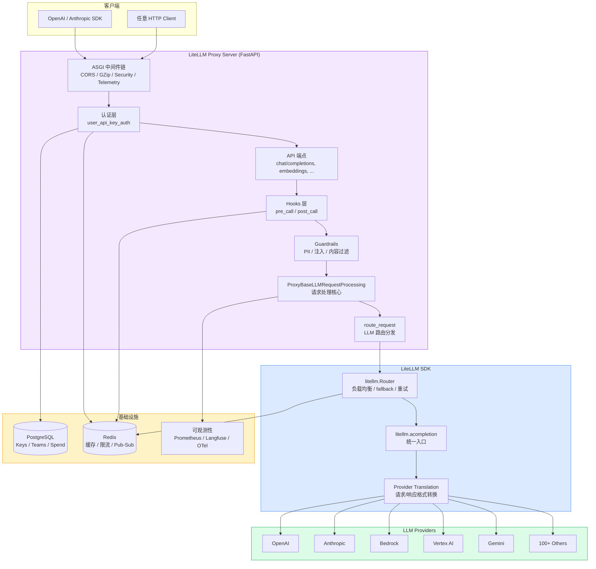
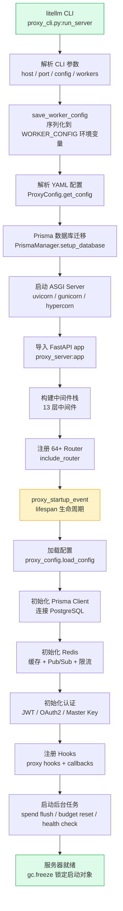
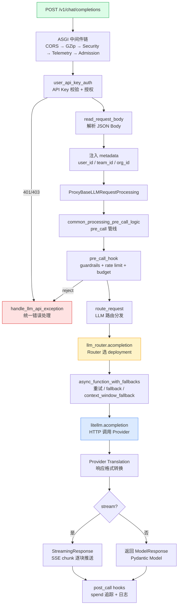
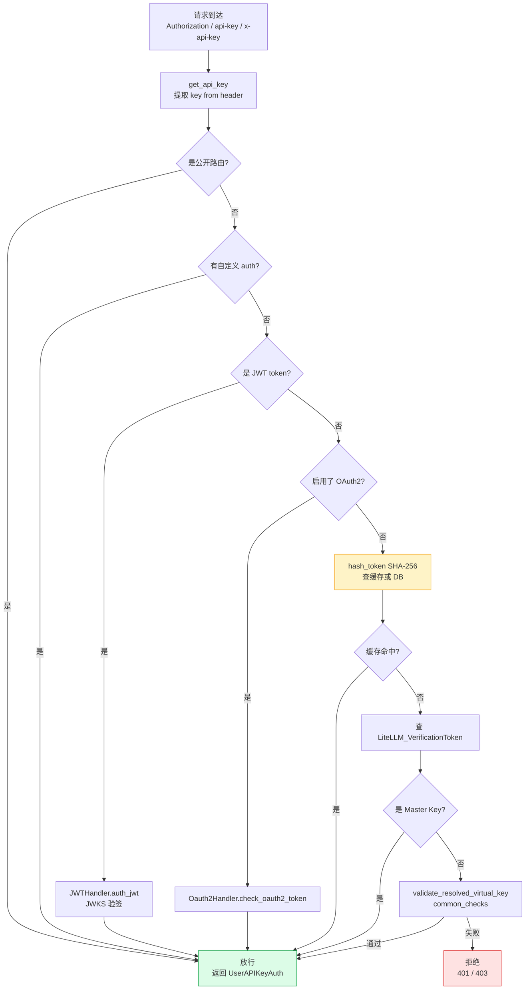
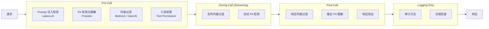
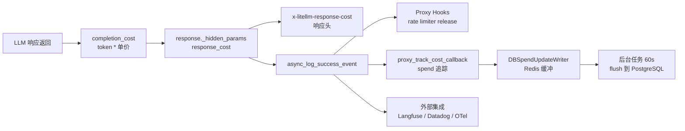
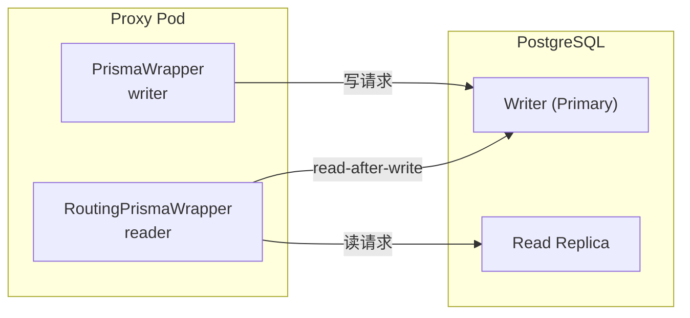

# LiteLLM Proxy Server 实现分析

本文基于 `litellm-main` 源码，系统梳理 LiteLLM Proxy Server（AI Gateway）的整体架构、启动流程、请求处理、认证授权、中间件、API 端点、护栏安全、可观测性、缓存、数据库与配置管理等核心模块。

---

## 目录

- [1. 概述](#1-概述)
- [2. 整体架构](#2-整体架构)
- [3. 启动流程](#3-启动流程)
- [4. 请求处理管线](#4-请求处理管线)
- [5. 认证与授权](#5-认证与授权)
- [6. 中间件与 Hooks](#6-中间件与-hooks)
- [7. API 端点与路由](#7-api-端点与路由)
- [8. 护栏与安全](#8-护栏与安全)
- [9. 日志回调与可观测性](#9-日志回调与可观测性)
- [10. 缓存系统](#10-缓存系统)
- [11. 预算与花费追踪](#11-预算与花费追踪)
- [12. 速率限制与节流](#12-速率限制与节流)
- [13. 小结](#13-小结)

---

## 1. 概述

LiteLLM Proxy Server 是一个基于 FastAPI 的 AI Gateway，提供 OpenAI 兼容的统一 API 接口，内部代理到 100+ LLM Provider。其核心定位：

- **统一接口**：客户端用 OpenAI SDK 即可访问所有 LLM（OpenAI / Anthropic / Bedrock / Vertex / Gemini 等）
- **企业级管控**：API Key 管理、预算控制、速率限制、 spend 追踪
- **智能路由**：fallback、重试、负载均衡、基于成本的选路、complexity router
- **安全护栏**：PII 检测、Prompt 注入防护、内容过滤、工具权限
- **可观测性**：Langfuse / Datadog / Prometheus / OpenTelemetry 等 40+ 集成

入口命令：`litellm --config proxy_server_config.yaml`

---

## 2. 整体架构

### 架构图



### 2.1 核心分层

| 层次 | 职责 | 关键文件 |
|------|------|----------|
| **ASGI 层** | CORS、GZip、安全头、限流准入 | `proxy/middleware/*.py` |
| **认证层** | API Key / JWT / OAuth2 校验 | `proxy/auth/user_api_key_auth.py` |
| **Hook 层** | pre_call / post_call 回调链 | `proxy/hooks/*.py` |
| **端点层** | 路由注册、请求解析 | `proxy/proxy_server.py` |
| **处理层** | 请求标准化、流式处理、错误处理 | `proxy/common_request_processing.py` |
| **路由层** | LLM 分发、fallback、重试 | `proxy/route_llm_request.py` |
| **SDK 层** | Provider 调用、格式转换 | `litellm/main.py`, `litellm/router.py` |

---

## 3. 启动流程

### 启动流程图



### 3.1 CLI 入口 (`proxy_cli.py`)

`run_server()` 函数（line 771-1682）是 CLI 主入口。关键参数：

| 参数 | 默认值 | 说明 |
|------|--------|------|
| `--host` | 0.0.0.0 | 监听地址 |
| `--port` | 4000 | 监听端口 |
| `--config` / `-c` | - | YAML 配置文件路径 |
| `--num_workers` | 1 | Worker 数量 |
| `--run_gunicorn` | false | 使用 Gunicorn |
| `--reload` | false | 开发模式热重载 |
| `--prometheus_metrics_port` | - | 独立 Prometheus 端口 |

### 3.2 FastAPI App 创建 (`proxy_server.py`)

```python
# line 1943
app = FastAPI(
    title="LiteLLM Proxy",
    lifespan=proxy_startup_event,   # 启动/关闭生命周期
    docs_url="/docs",
    ...
)
```

### 3.3 Lifespan 启动序列 (`proxy_startup_event`, line 1398-1857)

10 个阶段依次执行：

| 阶段 | 内容 |
|------|------|
| Phase 1 | 初始化日志、运行 WORKER_STARTUP_HOOKS |
| Phase 2 | License 检查、加载 Master Key |
| Phase 3 | `proxy_config.load_config()` 加载 YAML/DB 配置 |
| Phase 4 | Prisma Client 连接、数据库迁移 |
| Phase 5 | Redis 初始化（协调 Redis + 事务缓冲 Redis） |
| Phase 6 | OpenTelemetry Provider 初始化 |
| Phase 7 | JWT / OAuth2 认证初始化 |
| Phase 8 | 启动后台定时任务 |
| Phase 9 | Lens tracing + 遥测启动 |
| Phase 10 | Admin MCP + `gc.freeze()` 锁定 |

### 3.4 后台定时任务

| 任务 | 间隔 | 说明 |
|------|------|------|
| `update_spend` | 60s | 批量写 spend 到 PostgreSQL |
| `reset_budget` | 10-12min | 重置预算计数器 |
| `add_deployment` | 10s | 同步新模型部署 |
| `_run_background_health_check` | 持续 | 健康检查 model deployments |
| `send_weekly_spend_report` | 每周 | Slack 花费报告 |
| `process_rotations` | 1hr | 自动轮转 API Key |

---

## 4. 请求处理管线

### 请求流程图



### 4.1 核心处理类

`ProxyBaseLLMRequestProcessing`（`common_request_processing.py:1951`）是请求处理的核心：

1. **`base_process_llm_request()`**（line 2726）— 入口，包裹 SSE keepalive
2. **`_process_llm_request()`**（line 2791）— 编排 pre_call → LLM 调用 → 后处理
3. **`common_processing_pre_call_logic()`**（line 2137）— pre_call 管线

### 4.2 Pre-Call 管线（按顺序）

| 步骤 | 说明 |
|------|------|
| `add_litellm_data_to_request()` | 注入 version、headers、arrival_time 等 |
| `resolve_inference_model()` | 应用默认模型、CLI 覆盖 |
| Model alias 解析 | `litellm.model_alias_map` + key 级别别名 |
| 层级化 router_settings | key/team 级别覆盖 |
| `function_setup()` | 构造 `LiteLLMLoggingObj` |
| 合并 model-level guardrails | 从 litellm_params 合并 |
| `pre_call_hook()` | 执行 guardrail 管线 + 速率限制 + 预算检查 |

### 4.3 路由分发 (`route_request`, `route_llm_request.py:599`)

优先级：
1. 请求中含 `api_key` / `api_base` → 直接调用 `litellm.acompletion()`
2. 逗号分隔多模型 → `abatch_completion()`
3. `user_config` 路由 → 临时构造 Router
4. 标准路径 → `llm_router.acompletion(**data)`

### 4.4 流式 vs 非流式

- **流式**：检测 `data["stream"]`，使用 `async_data_generator()` 生成 SSE chunk，支持 keepalive ping、首 chunk 错误检测、Anthropic SSE 格式
- **非流式**：直接返回 Pydantic Model，post_call hooks 异步执行

### 4.5 错误处理与重试

三层重试/容错：

| 层次 | 机制 | 位置 |
|------|------|------|
| Proxy 层 | 速率限制 fallback 到备选模型 | `_pre_call_with_fallbacks` |
| Router 层 | `num_retries` / `fallbacks` / `context_window_fallbacks` / `content_policy_fallbacks` | `async_function_with_fallbacks` |
| 请求级 | key/team `router_settings` 覆盖 fallback 策略 | per-request override |

---

## 5. 认证与授权

### 认证流程图



### 5.1 支持的认证方式

| 方式 | 触发条件 | 文件 |
|------|----------|------|
| API Key (`sk-` 前缀) | 默认 | `auth/user_api_key_auth.py` |
| JWT (JWKS/OIDC) | `enable_jwt_auth=true` | `auth/handle_jwt.py` |
| OAuth2 Introspection | `enable_oauth2_auth=true` | `auth/oauth2_check.py` |
| OAuth2 Proxy Header | `enable_oauth2_proxy_auth=true` | `auth/oauth2_proxy_hook.py` |
| Master Key | `LITELLM_MASTER_KEY` env | 硬编码比对 |
| 自定义 Auth | `user_custom_auth` config | 用户定义 callable |
| AWS SigV4 | `Credential=Bearer ...` | 内置解析 |
| HTTP Basic | Basic auth header | 内置解析 |

### 5.2 Key 存储与查找

```
请求 API Key → hash_token(SHA-256) → UserApiKeyCache (内存 LRU + Redis)
                                          │
                                    cache miss?
                                          │
                                          ▼
                              PostgreSQL: LiteLLM_VerificationToken
                                          │
                                    查到后回写缓存
```

### 5.3 授权检查 (common_checks)

Key 解析后，执行以下检查：

1. Team/Project 是否被封禁
2. Team/Key 是否有权调用该模型 (`can_key_call_model`)
3. Team/Key/User 预算是否超支
4. 组织级别检查
5. 模型区域限制 (`allowed_model_region`)
6. 向量存储 / MCP 访问权限

---

## 6. 中间件与 Hooks

### 中间件栈（由外到内）

Starlette 中最后添加的中间件在最外层。请求从外到内经过：


### 6.1 Hook 注册表

`proxy/hooks/__init__.py` 定义了 `PROXY_HOOKS`：

| Hook | 文件 | 说明 |
|------|------|------|
| `parallel_request_limiter` | `parallel_request_limiter_v3.py` | 多实例并行请求限制 |
| `cache_control_check` | `cache_control_check.py` | Cache-Control 校验 |
| `responses_id_security` | `responses_id_security.py` | Response ID 防重放 |
| `litellm_skills` | `litellm_skills/main.py` | Skills 注入 |
| `max_iterations_limiter` | `max_iterations_limiter.py` | 迭代次数上限 |
| `max_budget_per_session_limiter` | `max_budget_per_session_limiter.py` | 会话预算上限 |
| `sensitive_data_routing` | `sensitive_data_routing.py` | 敏感数据路由 |
| `prompt_cache_prediction` | `prompt_cache_prediction.py` | Prompt 缓存预测 |

### 6.2 Hook 生命周期

```
pre_call:
  async_pre_call_hook(user_api_key_dict, cache, data, call_type)
  → 可返回 None(放行) / dict(改写请求) / Exception(拒绝)

post_call:
  async_post_call_success_hook(data, response)
  async_post_call_streaming_hook(chunk)
  async_post_call_failure_hook(exception)

logging:
  async_log_success_event(kwargs, response_obj)
  async_log_failure_event(kwargs, exception)
```

---

## 7. API 端点与路由

### 端点总览

LiteLLM Proxy 提供 3 层路由注册：

| 层次 | 方式 | 数量 |
|------|------|------|
| Eager Router | `app.include_router()` 启动时注册 | 64+ |
| Lazy Feature | 首次访问 URL 前缀时激活 | 20+ |
| Direct `@app` | WebSocket、root 等 | 少量 |

### 7.1 OpenAI 兼容端点

| 端点 | 路径 |
|------|------|
| Chat Completions | `POST /v1/chat/completions` |
| Completions | `POST /v1/completions` |
| Embeddings | `POST /v1/embeddings` |
| Moderations | `POST /v1/moderations` |
| Audio (TTS/STT) | `POST /v1/audio/speech`, `/v1/audio/transcriptions` |
| Models | `GET /v1/models` |
| Files | `/v1/files` CRUD |
| Batches | `/v1/batches` |
| Fine-tuning | `/v1/fine_tuning/jobs` |
| Assistants | `/v1/assistants` |
| Threads | `/v1/threads` |
| Images | `/v1/images/generations`, `/v1/images/edits` |
| Responses | `/v1/responses` (WebSocket) |
| Realtime | `/v1/realtime` (WebRTC) |
| Vector Stores | `/v1/vector_stores` |
| Rerank | `POST /v1/rerank` |
| Video | `/v1/videos` |
| Search | `/v1/search` |
| RAG | `/v1/rag/ingest`, `/v1/rag/query` |
| Containers | `/v1/containers` |

### 7.2 Provider-Specific 端点

| Provider | 端点 | 说明 |
|----------|------|------|
| Anthropic | `POST /v1/messages` | Messages API |
| Google | `/v1beta/models/{model}:generateContent` | Gemini 原生 |
| Vertex AI | `/vertex_ai/live` (WebSocket) | Live API |
| Azure | `/azure/{endpoint:path}` | 透传 |
| Bedrock | `/bedrock/{endpoint:path}` | 透传 |
| Cohere | `/cohere/{endpoint:path}` | 透传 |
| Mistral | `/mistral/{endpoint:path}` | 透传 |

### 7.3 管理端点

| 功能 | 路径前缀 |
|------|----------|
| Key 管理 | `/key/*` |
| Team 管理 | `/team/*` |
| User 管理 | `/user/*` |
| Org 管理 | `/org/*` |
| 预算 | `/budget/*` |
| Spend | `/spend/*` |
| Model | `/model/*` |
| Config | `/config/*` |
| Health | `/health`, `/health/history` |
| Callback | `/callback/*` |

---

## 8. 护栏与安全

### 8.1 护栏架构



### 8.2 支持的护栏类型

| 类型 | 实现 | 说明 |
|------|------|------|
| Prompt 注入 | `lakera_ai.py` | Lakera AI / Azure Prompt Shield |
| PII 脱敏 | `presidio.py` | Microsoft Presidio |
| 内容过滤 | 30+ vendor | Bedrock / OpenAI Moderations / Azure |
| 工具权限 | `tool_permission.py` | allow/deny 规则 |
| LLM-as-Judge | `llm_as_a_judge/` | LLM 评估内容 |
| 自定义代码 | `custom_code/` | 沙盒执行用户 Python |
| MCP 安全 | `mcp_security/` | MCP 工具调用验证 |

### 8.3 合规检查

`ComplianceChecker` 支持：
- **EU AI Act**：Art. 9 (guardrail check)、Art. 5 (pre-call screening)、Art. 12 (audit)
- **GDPR**：Art. 32 (data protection)、Art. 5(1)(c) (sensitive data)

### 8.4 第三方集成（50+）

Aporia AI、AWS Bedrock、Azure Content Safety、CrowdStrike、DynamoAI、Guardrails AI、HiddenLayer、IBM Guardrails、Lakera AI、Lasso、Model Armor、Noma、Pangea、Pillar、Presidio、TypeSafe、Zscaler AI Guard 等。

---

## 9. 日志回调与可观测性

### 9.1 Callback 系统



### 9.2 支持的集成（40+）

| 类别 | 集成 |
|------|------|
| Tracing | Langfuse, LangSmith, Datadog, OpenTelemetry, Helicone |
| Metrics | Prometheus (独立进程 + 多 worker 聚合) |
| Logging | GCS, S3, Webhook, Slack, Email |
| Spend | 内置 spend tracker, 每日聚合表 |
| Custom | 用户自定义 callback (via `litellm.callbacks`) |

### 9.3 费用追踪流程

1. LLM 响应返回 → `completion_cost()` 计算 token * 单价
2. 存入 `response._hidden_params["response_cost"]`
3. `common_request_processing.py` 提取到 `x-litellm-response-cost` 响应头
4. `proxy_track_cost_callback` 追踪 spend per key/user/team/org
5. `DBSpendUpdateWriter` 缓冲到 Redis
6. 后台 `update_spend` 任务每 60s 刷写到 PostgreSQL

---

## 10. 缓存系统

### 10.1 缓存层级

| 层 | 用途 | 后端 |
|----|------|------|
| UserApiKeyCache | API Key 信息 | 内存 LRU + Redis (DualCache) |
| InternalUsageCache | 限流计数器、rate limit | 内存 + Redis |
| Router.cache | TPM/RPM 追踪、cooldown | 内存 + Redis |
| LLMCachingHandler | LLM 响应缓存 | 可配置后端 |

### 10.2 支持的缓存后端

- **In-Memory** (LRU)
- **Redis** / **Redis Cluster**
- **S3** / **GCS** / **Azure Blob**
- **Disk**
- **Qdrant Semantic Cache** (向量相似度)

### 10.3 缓存管理端点

| 端点 | 说明 |
|------|------|
| `GET /cache/ping` | 缓存健康检查 |
| `POST /cache/delete` | 删除缓存条目 |
| `POST /cache/flushall` | 清空全部缓存 |
| `GET /cache/redis/info` | Redis 信息 |

---

## 11. 数据库与配置管理

### 11.1 数据库 Schema（65+ 表）

```mermaid
erDiagram
    VerificationToken ||--o{ SpendLogs : "generates"
    TeamTable ||--o{ VerificationToken : "owns"
    TeamTable ||--o{ TeamMembership : "has"
    UserTable ||--o{ TeamMembership : "belongs"
    OrganizationTable ||--o{ TeamTable : "contains"
    ProxyModelTable ||--o{ SpendLogs : "served by"
    BudgetTable ||--o{ VerificationToken : "limits"
    BudgetTable ||--o{ TeamTable : "limits"
    GuardrailsTable ||--o{ PolicyTable : "used in"
    PolicyTable ||--o{ PolicyAttachmentTable : "attached"

    VerificationToken {
        string token hashed
        string user_id
        string team_id
        float spend
        float max_budget
        int tpm_limit
        int rpm_limit
        json aliases
    }
    TeamTable {
        string team_id
        string team_alias
        float max_budget
        json models
        json members_with_roles
    }
    SpendLogs {
        string request_id
        string api_key
        string model
        int prompt_tokens
        int completion_tokens
        float spend
    }
    ProxyModelTable {
        string model_id
        string model_name
        json litellm_params
        json model_info
        boolean blocked
    }
```

核心表分类：

| 分类 | 表 |
|------|-----|
| 身份与访问 | VerificationToken, UserTable, TeamTable, OrganizationTable, BudgetTable |
| 模型与路由 | ProxyModelTable, CredentialsTable, AdaptiveRouterState |
| Spend 追踪 | SpendLogs, DailyUserSpend, DailyGlobalSpend, DailyTeamSpend |
| 护栏与策略 | GuardrailsTable, PolicyTable, PolicyAttachmentTable |
| MCP & 工具 | MCPServerTable, ToolTable, SkillsTable |
| 配置 | Config, CacheConfig, UISettings, SSOConfig |

### 11.2 配置管理

**配置优先级**（高到低）：

1. YAML 配置文件（config-owned）
2. 数据库（`LiteLLM_Config` 表）
3. 环境变量
4. 默认值

**热更新机制**：

| 机制 | 说明 |
|------|------|
| Redis Pub/Sub | 配置变更通知所有 Pod（channel: `litellm_proxy.config_change`） |
| 定期重载 | `model_cost_map_reload_config` 控制周期刷新 |
| DB 变更触发 | 写入 16+ 表时自动发 Pub/Sub |

### 11.3 数据库连接架构



- **读写分离**：读走 Read Replica，写走 Writer
- **Writer-Pinned Client**：保证 read-after-write 一致性
- **Token Auth**：支持 AWS RDS IAM / Azure Entra ID 短期 token
- **PgBouncer**：自动检测并适配

---

## 12. 关键函数索引

| 函数 | 文件 | 行号 | 说明 |
|------|------|------|------|
| `run_server` | `proxy/proxy_cli.py` | 771 | CLI 入口 |
| `proxy_startup_event` | `proxy/proxy_server.py` | 1398 | Lifespan 启动 |
| `ProxyConfig.load_config` | `proxy/proxy_server.py` | 6623 | 加载配置 |
| `chat_completion` | `proxy/proxy_server.py` | 12714 | Chat 端点 |
| `user_api_key_auth` | `proxy/auth/user_api_key_auth.py` | 4186 | 认证入口 |
| `user_api_key_auth_builder` | `proxy/auth/user_api_key_auth.py` | 2068 | 认证状态机 |
| `get_key_object` | `proxy/auth/auth_checks.py` | 4194 | Key 查找 |
| `common_checks` | `proxy/auth/auth_checks.py` | 1067 | 授权检查 |
| `base_process_llm_request` | `proxy/common_request_processing.py` | 2726 | 请求处理入口 |
| `common_processing_pre_call_logic` | `proxy/common_request_processing.py` | 2137 | Pre-call 管线 |
| `route_request` | `proxy/route_llm_request.py` | 599 | LLM 路由分发 |
| `async_function_with_fallbacks` | `litellm/router.py` | 8405 | Router fallback |
| `async_data_generator` | `proxy/proxy_server.py` | 10468 | 流式 SSE 生成 |
| `handle_llm_api_exception` | `proxy/common_request_processing.py` | 4089 | 错误处理 |
| `pre_call_hook` | `proxy/utils.py` | 2478 | Hook 编排 |
| `completion_cost` | `litellm/cost_calculator.py` | - | 费用计算 |

---

## 13. 小结

### 设计要点

1. **分层架构**：ASGI 中间件 → 认证 → Hook → 端点 → 处理 → 路由 → SDK → Provider，职责清晰
2. **OpenAI 兼容**：所有主流 OpenAI API 端点均支持，同时兼容 Anthropic / Google / Azure 原生格式
3. **企业级管控**：多级预算（key/team/user/org）、并行请求限制、spend 实时追踪
4. **安全纵深**：输入验证 → SSRF 防护 → metadata 净化 → guardrail 管线 → 合规检查
5. **高可用**：读写分离、Redis 缓冲、后台批量写入、多 Pod Pub/Sub 配置同步
6. **可扩展**：50+ guardrail 集成、40+ 可观测性集成、自定义 hook/callback
7. **性能优化**：热路由优先排序、lazy feature 按需加载、Redis pipelining、连接池复用

### 一句话总结

> LiteLLM Proxy Server 是一个生产级 AI Gateway，通过 FastAPI + LiteLLM SDK 的分层架构，提供 OpenAI 兼容的统一 API，内置认证授权、智能路由、安全护栏、费用管控和可观测性，代理 100+ LLM Provider。
