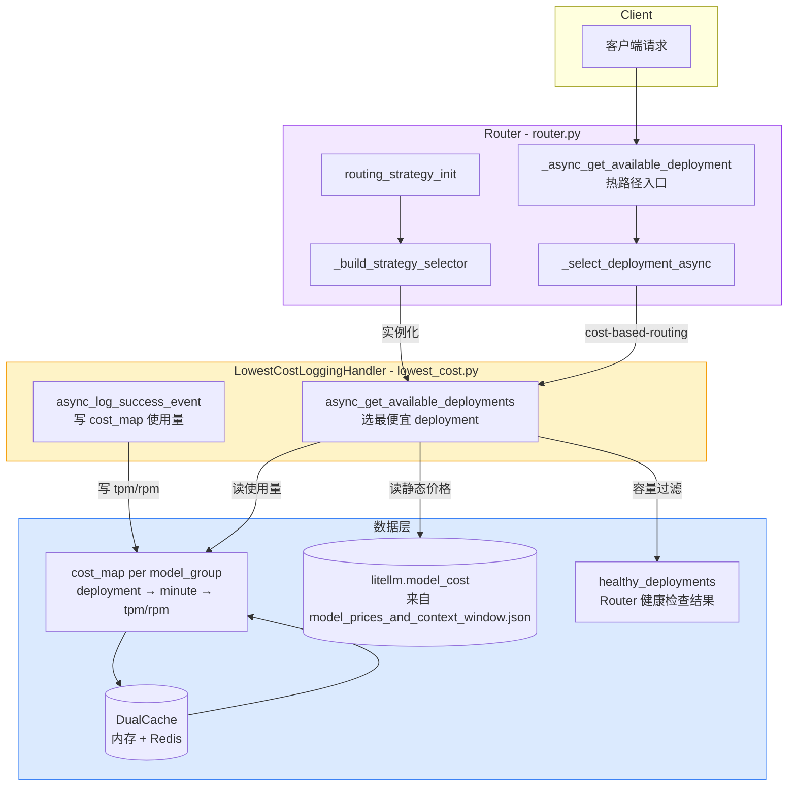
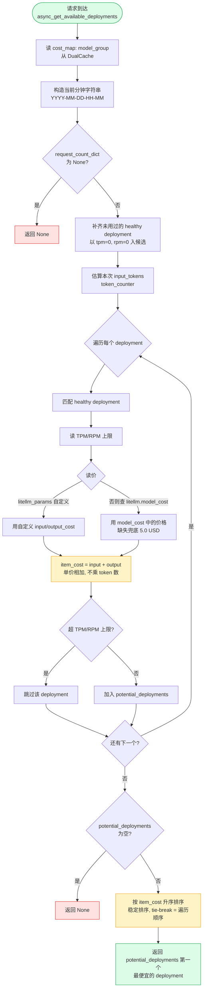
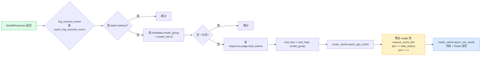
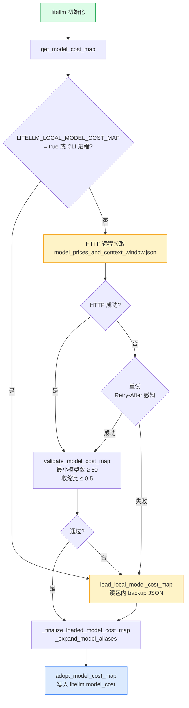
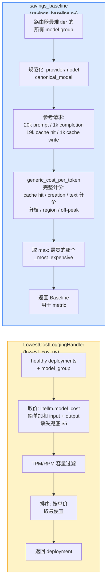

# LiteLLM 基于成本的选路（Cost-Based Routing）实现分析

本文基于 `litellm-main` 源码，系统梳理 `routing_strategy="cost-based-routing"`（最低成本选路）以及 `savings_baseline`（节省基线）的实现。

---

## 目录

- [1. 整体架构](#1.-整体架构)
  - [架构图](#架构图)
  - [1.1 类层次与入口](#1.1-类层次与入口)
  - [1.2 策略如何被 Router 选中](#1.2-策略如何被-router-选中)
  - [1.3 请求时如何调用 selector](#1.3-请求时如何调用-selector)
  - [1.4 策略名字面量定义](#1.4-策略名字面量定义)
- [2. 核心数据结构](#2.-核心数据结构)
  - [2.1 cost_map（运行时使用量缓存）](#2.1-cost_map运行时使用量缓存)
  - [2.2 litellm.model_cost（静态价格表）](#2.2-litellm.model_cost静态价格表)
  - [2.3 _REFERENCE_REQUEST（savings baseline 用）](#2.3-_reference_requestsavings-baseline-用)
  - [2.4 Baseline（savings baseline 的 NamedTuple）](#2.4-baselinesavings-baseline-的-namedtuple)
- [3. 算法流程（LowestCostLoggingHandler.async_get_available_deployments）](#3.-算法流程lowestcostlogginghandler.async_get_available_deployments)
  - [选路流程图](#选路流程图)
  - [3.1 选 deployment 的步骤](#3.1-选-deployment-的步骤)
  - [3.2 关键行为观察](#3.2-关键行为观察)
  - [3.3 使用量的写入（成功回调）](#3.3-使用量的写入成功回调)
    - [成功回调数据流](#成功回调数据流)
- [4. Cost 计算方式](#4.-cost-计算方式)
  - [价格加载链路图](#价格加载链路图)
  - [4.1 价格如何加载](#4.1-价格如何加载)
  - [4.2 路由内如何取价](#4.2-路由内如何取价)
  - [4.3 全链路 cost_per_token（非路由使用）](#4.3-全链路-cost_per_token非路由使用)
- [5. savings_baseline 与 lowest-cost 的差异](#5.-savings_baseline-与-lowest-cost-的差异)
  - [两者对比图](#两者对比图)
- [6. 关键配置参数与默认值](#6.-关键配置参数与默认值)
- [7. 关键函数 / 位置索引](#7.-关键函数---位置索引)
- [8. 外部文档入口](#8.-外部文档入口)
- [9. 小结 / 设计要点](#9.-小结---设计要点)


## 1. 整体架构

### 架构图



### 1.1 类层次与入口

```
litellm.Router                                  # 选路主入口
    └── routing_strategy_init()                 # 初始化策略 selector
        └── _build_strategy_selector()          # 根据 strategy 字符串构造 selector
            └── LowestCostLoggingHandler        # cost-based-routing 的 selector
                 ├── async_log_success_event()  # 成功回调：写入 cost_map 使用量
                 └── async_get_available_deployments()  # 选出最便宜的 deployment

BaseRoutingStrategy (ABC)                       # 其他策略的基类（ TPM/RPM/延迟/预算 等）
    └── 周期性 in-memory <-> Redis 同步
```

关键点：`LowestCostLoggingHandler` 并 **不** 继承 `BaseRoutingStrategy`，它继承的是 `CustomLogger`（`litellm/integrations/custom_logger.py`），作为回调 hook 注册到 Router。代价计算是纯"静态价格 + 每分钟使用量"，不走 `BaseRoutingStrategy` 的 budget 同步路径。

### 1.2 策略如何被 Router 选中

入口在 `Router.__init__`：

- `litellm/router.py:L1162` — `routing_strategy: RoutingStrategyName = "simple-shuffle"`
- `litellm/router.py:L1450` — `self.routing_strategy = self._normalize_strategy(routing_strategy)`
- `litellm/router.py:L1508` — 调用 `self.routing_strategy_init(routing_strategy, routing_strategy_args)`

`routing_strategy_init` 位于 `litellm/router.py:L1809`，它：

1. 调用 `_validate_routing_strategy()`（`router.py:L1697` → `router_utils/routing_groups.py:L23`）确认名字在 `VALID_ROUTING_STRATEGIES` 中。
2. 调用 `_build_strategy_selector()`（`router.py:L1701`）按 `match` 分派：

```python
# litellm/router.py:L1731-L1735
case RoutingStrategy.COST_BASED.value:    # "cost-based-routing"
    selector = LowestCostLoggingHandler(
        router_cache=self.cache,
        routing_args={},
    )
```

3. 把 selector 挂到默认属性 `self.lowestcost_logger`（映射表在 `router.py:L1679-L1685`：`"cost-based-routing": "lowestcost_logger"`）。

### 1.3 请求时如何调用 selector

`Router._async_get_available_deployment`（`router.py:L14504`）是选路热路径：

1. 跑 pre-routing hook、得到 healthy deployments；
2. 如果是 `"simple-shuffle"` 走 `simple_shuffle()`；
3. 否则调用 `_select_deployment_async`（`router.py:L2170`），其中 `cost-based-routing` 与 `usage-based-routing-v2` 走同一分支：

```python
# litellm/router.py:L2199-L2205
case "usage-based-routing-v2" | "cost-based-routing":
    return await selector.async_get_available_deployments(
        model_group=model,
        healthy_deployments=healthy_deployments,
        messages=messages,
        input=input,
    )
```

注意：同步路径 `_select_deployment_sync`（`router.py:L2235-L2237`）显式 **不** 支持 `cost-based-routing`，因为 `LowestCostLoggingHandler` 只实现了 async 版本。

### 1.4 策略名字面量定义

- `litellm/types/router.py:L1157-L1163` — `RoutingStrategy` 枚举：
  - `COST_BASED = "cost-based-routing"`
- `litellm/types/litellm_params.py:L45-L53` — `RoutingStrategyName: TypeAlias = Literal["simple-shuffle","least-busy","usage-based-routing","latency-based-routing","cost-based-routing","usage-based-routing-v2","lar1"]`
- `litellm/router_utils/routing_groups.py:L20` — `VALID_ROUTING_STRATEGIES` 由枚举值 + `"simple-shuffle"`/`"lar1"` 拼装。

---

## 2. 核心数据结构

### 2.1 `cost_map`（运行时使用量缓存）

存储在每个 model_group 的 cache key 下，结构见 `lowest_cost.py:L45-L53`：

```
cost_map:{model_group} -> {
    deployment_id: {
        "YYYY-MM-DD-HH-MM": { "tpm": <int>, "rpm": <int> }
    }
}
```

- key 格式：`f"cost_map:{model_group}"`（`lowest_cost.py:L58`, `L130`, `L187`）
- value 是一个 dict-of-dict，外层键是 deployment id，内层键是精确到分钟的字符串。
- 由 `self.router_cache`（`DualCache`，内存 + 可选 Redis）承载。

### 2.2 `litellm.model_cost`（静态价格表）

- 由 `litellm/litellm_core_utils/get_model_cost_map.py` 加载。
- 最终写入 `litellm.model_cost`（`get_model_cost_map.py:L659` `adopt_model_cost_map`）。
- 每个 model 条目包含 `input_cost_per_token`、`output_cost_per_token` 等字段（来自 `model_prices_and_context_window.json`）。
- `LowestCostLoggingHandler` 直接读取该全局 dict：`lowest_cost.py:L247` — `litellm.model_cost.get(item_litellm_model_name, {})`。

### 2.3 `_REFERENCE_REQUEST`（savings baseline 用）

定义在 `savings_baseline.py:L27-L32`：

```python
_REFERENCE_REQUEST = Usage(
    prompt_tokens=20_000,
    completion_tokens=1_000,
    total_tokens=21_000,
    prompt_tokens_details=PromptTokensDetailsWrapper(
        cached_tokens=19_000,
        cache_creation_tokens=1_000,
        text_tokens=0,
    ),
)
```

一个固定的"参考请求"，用来给候选 baseline 模型定价。

### 2.4 `Baseline`（savings baseline 的 NamedTuple）

`savings_baseline.py:L35-L45`：

```python
class Baseline(NamedTuple):
    model: str                  # provider/model 形式，用于计价
    deployment_id: str | None = None   # 只用于排名
```

---

## 3. 算法流程（`LowestCostLoggingHandler.async_get_available_deployments`）

### 选路流程图



### 3.1 选 deployment 的步骤

1. **读使用量**（L187-L189）
   ```python
   cost_key = f"cost_map:{model_group}"
   request_count_dict = await self.router_cache.async_get_cache(key=cost_key) or {}
   ```

2. **构造当前分钟字符串**（L196-L199）
   `precise_minute = "YYYY-MM-DD-HH-MM"`

3. **空缓存兜底**（L201-L202）：`request_count_dict is None` 时直接 return。

4. **补齐未用过的 healthy deployment**（L204-L210）：
   ```python
   for d in healthy_deployments:
       if d["model_info"]["id"] not in all_deployments:
           all_deployments[d["model_info"]["id"]] = {
               precise_minute: {"tpm": 0, "rpm": 0},
           }
   ```
   **关键点**：从未被用过的 deployment 以 0/0 进入候选，这样冷启动时"没人用过"也能参与比价。

5. **估算本次输入 token**（L212-L215）：
   ```python
   input_tokens = token_counter(messages=messages, text=input) or 0
   ```
   用于后面 TPM 上限检查（`item_tpm + input_tokens > _deployment_tpm`）。

6. **遍历每个 deployment，计算 `item_cost` 并过滤**（L222-L296）：
   - 找到对应的 healthy deployment；
   - 读取该 deployment 的 TPM/RPM 上限（`tpm`/`rpm` 字段，缺失则 `float("inf")`）；
   - **取价**：
     - 优先读 `litellm_params.input_cost_per_token` / `output_cost_per_token`（`lowest_cost.py:L252-L256`），即用户在 model_list 中显式给出的自定义定价；
     - 否则回落到 `litellm.model_cost.get(model_name, {}).get("input_cost_per_token", 5.0)`（`L258-L262`）。
     - **兜底 5.0**（美元）：若 model 不在 `model_cost` 中，input 和 output 都按 5.0 计价（`L264` 注释：`if litellm["model"] is not in model_cost map -> use item_cost = $10`）。
   - `item_cost = item_input_cost + item_output_cost`（L266）。
   - **超限过滤**（L291-L294）：
     ```python
     if item_tpm + input_tokens > _deployment_tpm or item_rpm + 1 > _deployment_rpm:
         continue
     ```
     超 TPM 或 RPM 上限的直接剔除。
   - 通过的进入 `potential_deployments.append((_deployment, item_cost))`。

7. **排序取最便宜的**（L298-L303）：
   ```python
   if len(potential_deployments) == 0:
       return None
   potential_deployments = sorted(potential_deployments, key=lambda x: x[1])
   selected_deployment = potential_deployments[0][0]
   return selected_deployment
   ```

### 3.2 关键行为观察

- **无历史数据**：首次请求时 `request_count_dict` 为空 dict `{}`，所有 healthy deployment 都被补齐为 0/0（L204-L210），因此都会进入比价，选最便宜的；没有任何 TPM/RPM 上限约束时，所有 deployment 都通过，排序稳定由 `item_cost` 决定。
- **Tie-break**：`sorted(..., key=lambda x: x[1])` 是稳定排序，cost 相等时保留遍历顺序（即 `all_deployments.items()` 的 dict 顺序，本质是插入/缓存加载顺序）。**没有显式随机打散**。代码里 L217 注释 `# randomly sample from all_deployments, incase all deployments have latency=0.0` 是遗留注释，当前实现并未真正随机化。
- **Cooldown**：`LowestCostLoggingHandler` 本身 **不** 处理 cooldown（grep `cooldown` 在本文件无结果）。cooldown 由 Router 的 healthy-check 与 `get_healthy_deployments` 在外层剔除，selector 只看到已经被判定健康的 deployment。
- **Cost 是静态的**：选路时用的 `item_cost = input_cost + output_cost`，只与价格率有关，**与历史实际花费、TPM/RPM 计数无关**。换言之：`lowest_cost` 本质是"在还没超限的 deployment 中，挑价目表最便宜的那个"；TPM/RPM 计数只用来做容量过滤。
- **调试字段**：`_cost_per_deployment`（L286）仅用于 Langfuse/Slack 调试日志，不参与决策（L282-L283 注释）。

### 3.3 使用量的写入（成功回调）

#### 成功回调数据流



- 同步：`log_success_event`（`lowest_cost.py:L24`）
- 异步：`async_log_success_event`（`lowest_cost.py:L100`）

两者逻辑一致：

1. 跳过 batch retrieve 调用类型（`is_batch_retrieve_call_type`）；
2. 读 `metadata.model_group` 与 `model_info.id`，缺任一即跳过；
3. 取 `response_obj.usage.total_tokens`（仅 `ModelResponse` 且 `usage` 为 `litellm.Usage`）；
4. 在 `cost_map:{model_group}` 下，对该 deployment 的当前分钟累加 `tpm`（加 total_tokens）与 `rpm`（+1）；
5. 写回 `router_cache`（内存 + Redis 双写由 `DualCache` 处理）。

---

## 4. Cost 计算方式

### 价格加载链路图



### 4.1 价格如何加载

- 入口：`get_model_cost_map()`（`litellm/litellm_core_utils/get_model_cost_map.py:L715`）。
- 默认尝试 HTTP 远程拉取 `model_prices_and_context_window.json`；失败回落到包内 `model_prices_and_context_window_backup.json`（`L79-L94`）。
- 环境变量 `LITELLM_LOCAL_MODEL_COST_MAP=true` 强制只读本地（`L740`）。
- 加载后走 `_finalize_loaded_model_cost_map`（`L645`）→ `_expand_model_aliases`（`L577`）展开别名。
- 通过 `adopt_model_cost_map()`（`L653`）写入 `litellm.model_cost`。
- 完整性校验：`validate_model_cost_map`（`L180`），含最小模型数 `MODEL_COST_MAP_MIN_MODEL_COUNT=50` 与最大收缩比 `MODEL_COST_MAP_MAX_SHRINK_RATIO=0.5`（`constants.py:L173-L177`）。

### 4.2 路由内如何取价

`lowest_cost.py:L246-L266` 已经说明：

```python
item_litellm_model_name = _deployment["litellm_params"]["model"]
item_litellm_model_cost_map = litellm.model_cost.get(item_litellm_model_name, {})

# 自定义定价优先
item_input_cost  = litellm_params.get("input_cost_per_token")  or model_cost["input_cost_per_token"]  or 5.0
item_output_cost = litellm_params.get("output_cost_per_token") or model_cost["output_cost_per_token"] or 5.0
item_cost = item_input_cost + item_output_cost
```

注意：这里是**单价相加**，没有乘以 token 数 — `lowest_cost` 比较的是"单价之和"，而不是"这次调用的预估总花费"。也就是说 1M 输入 token 的模型与 1 token 的模型在选路时权重一样。

### 4.3 全链路 `cost_per_token`（非路由使用）

`litellm/cost_calculator.py:L405` 的 `cost_per_token()` 才是真正按 token 数计算一次调用成本（input_cost + output_cost）的函数。它依次：

1. 处理 `custom_cost_per_token`（用户自定义）；
2. 在 `litellm.model_cost` 中按 `{provider}/{region}/{model}` → `{provider}/{model}` → `{model}` 优先级查找（`L565-L590`）；
3. 分发给 provider 特定 cost calculator（如 `openai_cost_per_token`、`bedrock_cost_per_token` 等，`cost_calculator.py:L42-L110`）。

但 **选路** 流程不走这条路，只用上面 4.2 的简单加和。

---

## 5. `savings_baseline` 与 `lowest-cost` 的差异

### 两者对比图



`savings_baseline.py` 与 `LowestCostLoggingHandler` 在目的、输入、调用路径上都不同：

| 维度 | `LowestCostLoggingHandler` (lowest_cost.py) | `savings_baseline` (savings_baseline.py) |
|---|---|---|
| 目的 | 选最便宜的 healthy deployment | 计算"若没有路由器，流量会跑在最贵模型上的花费"，作为复杂度路由器节省额的对比基准 |
| 使用者 | `Router._select_deployment_async` | `ComplexityRouter`（`complexity_router/complexity_router.py:L1475` `self._savings_baseline`）及 spend 追踪（`proxy/spend_tracking/savings.py:L484`） |
| 触发时机 | 每次请求热路径 | 路由器初始化/配置变更时，由 complexity router 缓存（带 TTL） |
| 输入 | `model_group` 下的 healthy deployments | 路由器配置的最难 tier 里的所有 `group_names` |
| 价格来源 | `litellm.model_cost[model].{input,output}_cost_per_token` 简单加和 | 走 `generic_cost_per_token()`（`litellm/litellm_core_utils/llm_cost_calc/utils.py:L1319`）对一个固定 `_REFERENCE_REQUEST`（20k 输入 / 1k 输出 / 19k cache hit / 1k cache write）完整计价，包含 cache 折扣、分档定价等 |
| 结果 | 选出一个 deployment | 返回 `Baseline(model="provider/model", deployment_id=...)` 用于后续 metric |
| 失败语义 | 所有 deployment 超限 → 返回 `None`，上层抛 `NoDeploymentAllowed` | 全部失败 → 返回 `None`，把 savings driver 置零，**不会** 让请求失败（`savings_baseline.py:L156-L162` 显式吞异常） |

关键函数：

- `savings_baseline.py:L48` `canonical_model()` — 把 `(model, custom_llm_provider)` 规范化为 `provider/model`；对 `github_copilot`/`chatgpt` 这类会触发 OAuth 的 provider 仅按字符串处理，避免触发设备流。
- `savings_baseline.py:L73` `_models_in(router, group_name)` — 通过 `router.model_name_to_deployment_indices` 找到一个 group 的所有候选 deployment，处理 Azure 部署名 → `model_info.base_model` 的回落。
- `savings_baseline.py:L104` `_priced(router, candidate)` — 用 `generic_cost_per_token` 给候选定价，返回 `(cost, candidate)`；返回 `None` 表示不可定价。
- `savings_baseline.py:L137` `_most_expensive()` — 取 `max(priced)[1]`。
- `savings_baseline.py:L146` `resolve_baseline()` — 对外唯一入口；永不抛异常。

`generic_cost_per_token`（`llm_cost_calc/utils.py:L1319`）相对 `LowestCostLoggingHandler` 的加和：

- 处理 prompt caching：cache hit / cache creation / text token 分别计价；
- 处理分档（tiered table）、service tier、data residency 区域加成、off-peak、Vertex location；
- 通过 `get_model_info` 取完整 `ModelInfo`（可带 deployment 级别的自定义 rate，由 `Router.get_deployment_model_info` 合并，见 `router.py:L11823`）。

---

## 6. 关键配置参数与默认值

| 参数 | 默认值 | 含义 | 位置 |
|---|---|---|---|
| `routing_strategy` | `"simple-shuffle"` | Router 默认策略 | `router.py:L1162` |
| `routing_strategy_args` | `{}` | 策略额外参数（`lowest_cost` 收到的是空 dict，未使用） | `router.py:L1164` |
| `LITELLM_LOCAL_MODEL_COST_MAP` | 未设置 → 走远程 | 强制使用本地 cost map | `get_model_cost_map.py:L740` |
| `MODEL_COST_MAP_MIN_MODEL_COUNT` | `50` | 拉到的 cost map 至少要有几个 model | `constants.py:L173` |
| `MODEL_COST_MAP_MAX_SHRINK_RATIO` | `0.5` | 相对 backup 收缩超过 50% 视为脏数据 | `constants.py:L176` |
| `DEFAULT_REDIS_SYNC_INTERVAL` | `1` 秒 | `BaseRoutingStrategy` 内存→Redis 同步周期（`LowestCost` 不继承该基类，不适用） | `constants.py:L142` |
| `input_cost_per_token` / `output_cost_per_token`（model_cost 缺失时） | `5.0` 美元 | `lowest_cost.py` 中硬编码的兜底价格 | `lowest_cost.py:L259, L262` |
| `_REFERENCE_REQUEST` | 20k prompt / 1k completion / 19k cache hit | savings baseline 的参考请求 | `savings_baseline.py:L27` |

---

## 7. 关键函数 / 位置索引

| 名字 | 位置 |
|---|---|
| `LowestCostLoggingHandler` | `litellm/router_strategy/lowest_cost.py:L15` |
| `LowestCostLoggingHandler.log_success_event` | `lowest_cost.py:L24` |
| `LowestCostLoggingHandler.async_log_success_event` | `lowest_cost.py:L100` |
| `LowestCostLoggingHandler.async_get_available_deployments` | `lowest_cost.py:L176` |
| `BaseRoutingStrategy` | `litellm/router_strategy/base_routing_strategy.py:L17` |
| `BaseRoutingStrategy.periodic_sync_in_memory_spend_with_redis` | `base_routing_strategy.py:L104` |
| `resolve_baseline` | `litellm/router_strategy/savings_baseline.py:L146` |
| `canonical_model` | `savings_baseline.py:L48` |
| `_models_in` | `savings_baseline.py:L73` |
| `_priced` | `savings_baseline.py:L104` |
| `_most_expensive` | `savings_baseline.py:L137` |
| `Baseline` | `savings_baseline.py:L35` |
| `_REFERENCE_REQUEST` | `savings_baseline.py:L27` |
| `Router.__init__` | `litellm/router.py:L1162`（routing_strategy 参数） |
| `Router._normalize_strategy` | `router.py:L1687` |
| `Router._validate_routing_strategy` | `router.py:L1697` |
| `Router._build_strategy_selector` | `router.py:L1701`（cost-based 分支 `L1731`） |
| `Router.routing_strategy_init` | `router.py:L1809` |
| `Router._select_deployment_async` | `router.py:L2170`（`cost-based-routing` 分支 `L2199`） |
| `Router._select_deployment_sync` | `router.py:L2217`（显式不支持 cost-based） |
| `Router._async_get_available_deployment` | `router.py:L14504`（热路径入口） |
| `Router.get_deployment_model_info` | `router.py:L11823`（savings baseline 用） |
| `validate_routing_strategy` | `litellm/router_utils/routing_groups.py:L23` |
| `RoutingStrategy` enum | `litellm/types/router.py:L1157` |
| `RoutingStrategyName` | `litellm/types/litellm_params.py:L45` |
| `GetModelCostMap` | `litellm/litellm_core_utils/get_model_cost_map.py:L67` |
| `get_model_cost_map` | `get_model_cost_map.py:L715` |
| `adopt_model_cost_map` | `get_model_cost_map.py:L653` |
| `cost_per_token` | `litellm/cost_calculator.py:L405` |
| `generic_cost_per_token` | `litellm/litellm_core_utils/llm_cost_calc/utils.py:L1319` |
| `MODEL_COST_MAP_MIN_MODEL_COUNT` / `MODEL_COST_MAP_MAX_SHRINK_RATIO` | `litellm/constants.py:L173-L177` |
| `DEFAULT_REDIS_SYNC_INTERVAL` | `litellm/constants.py:L142` |

---

## 8. 外部文档入口

- 仓库主 README：`/home/wangwei/wei/workspacePy/gateway/litellm-main/README.md`（在全文搜索中未发现对 `cost-based-routing` 的专门章节）。
- 代码内部文档字符串：
  - `Router.__init__` 的 docstring（`router.py:L1209`）列出可用策略名：`"simple-shuffle", "least-busy", "usage-based-routing", "latency-based-routing", "cost-based-routing"`。
  - `savings_baseline.py` 顶部模块 docstring（L1-L15）解释了"为什么 baseline 是 provider-qualified + 基于参考请求而非实时请求"。
- 仓库内搜索 `docs/` 与 `README.md` 在本次扫描中未发现关于 `cost-based-routing` 的专门用户文档；相关用法主要依靠代码注释与 `cookbook/litellm_router/` 下的示例。
- 价格数据源：`model_prices_and_context_window.json`（根目录），本地备份 `litellm/model_prices_and_context_window_backup.json`。

---

## 9. 小结 / 设计要点

1. `cost-based-routing` 的"成本"是**静态单价加和**（`input + output` 每 token 费率），与历史 TPM/RPM 无关；TPM/RPM 仅用于容量过滤。
2. 与 `BaseRoutingStrategy` 家族不同，`LowestCostLoggingHandler` 直接挂在 `CustomLogger` 上，作为成功回调记录使用量、作为 selector 做选路决策。
3. Tie-break 依赖稳定排序，没有显式随机化；所有 deployment 价格相同或都缺失时，按 `all_deployments.items()` 的顺序返回第一个。
4. `savings_baseline` 与 `lowest_cost` 完全正交：前者为 complexity router 的反事实 metric 服务，调用完整的 `generic_cost_per_token` 引擎；后者是面向流量的实际选路策略。
5. 自定义定价（`litellm_params.input_cost_per_token`）优先级高于 `model_cost` 全局表，允许 per-deployment 覆盖。
6. 价格数据源具备远程拉取 + 本地 fallback + 完整性校验（最小模型数 / 收缩比）的三层保护，避免上游脏数据导致选路错误。
